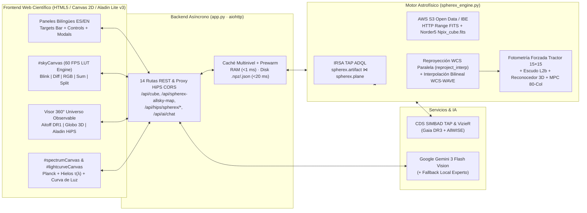

# SPHEREx SkyChrono

**Explorador Científico de Cielo Completo 360°, Blinking Multi-Época, Espectroscopía LVF (0.75–5.0 µm), Fotometría Forzada Tractor y Copiloto IA Astrofísico para NASA Space Apps Challenge 2026**

> **Reto Oficial:** *Planet X and SPHEREx* — NASA Space Apps Challenge 2026
> **Equipo:** Delegación Zuliana de Astronomía
> **Fuentes Oficiales:** NASA / IPAC IRSA SPHEREx Archive (`DR1`, `QR1`, `QR2`) · AWS Open Data (`s3://nasa-irsa-spherex/`) · CDS SIMBAD / VizieR (Gaia DR3 & AllWISE) · IAU Minor Planet Center (`C59`)

[](https://www.python.org/)
[](https://docs.aiohttp.org/)
[](https://www.astropy.org/)
[](https://irsa.ipac.caltech.edu/Missions/spherex.html)
[](https://doi.org/10.26131/IRSA679)
[](#-documentación-y-manuales-oficiales)

---

## 🌌 Resumen Ejecutivo

**SPHEREx SkyChrono** es una plataforma web astrofísica de código abierto diseñada para superar en velocidad exploratoria, análisis espectro-temporal y ergonomía científica a los visores tradicionales de archivos espaciales. Mientras que los portales convencionales exigen consultas manuales, descargas FITS completas de cientos de megabytes y tuberías externas en Python para alinear detectores, **SkyChrono** unifica en tiempo real:

1. **Visor Oficial 360° × 180° del Universo Observable (SPHEREx DR1 All-Sky Cube)**: Construido directamente a partir del cubo HiPS oficial de NASA/IPAC IRSA ([`ivo://IPAC/P/SPHEREx/DR1/cube`](https://irsa.ipac.caltech.edu/data/hips/SPHEREx/spherex_allsky_cube), DOI [`10.26131/IRSA679`](https://doi.org/10.26131/IRSA679)) y tiles `Norder5` `Npix{ipix}_cube.fits`, con **3 motores sincronizados** (Proyección Hammer-Aitoff 360°, Esfera Celeste 3D con rotación isotrópica libre y HiPS progresivo Aladin Lite v3) y **3 planos de referencia** (Galáctico, Eclíptico e ICRS Ecuatorial).
2. **Navegación Continua Multi-Época con Streaming FITS Parcial (`HTTP Range`)**: Arrastra cualquier región del cielo, haz zoom continuo en 7 niveles (`FOV 0.06° → 1.60°`) anclado al cursor o haz doble clic para consultar exposiciones reales Nivel 2b vía **IRSA TAP ADQL** y descargar únicamente los recortes WCS necesarios desde **AWS S3 Open Data** usando `astropy.io.fits` + `fsspec`.
3. **Blinking Multi-Época, Sustracción Diferencial ($\sigma_{\text{MAD}}$) y Detector IA de Dipolos**: Detecta automáticamente candidatos en movimiento (Planeta X / KBOs, cometa interestelar **3I/ATLAS**, enanas marrones ultrafrías Y/T como **WISE 0855−0714**, estrellas de alto movimiento propio como **Barnard's Star**) y variables infrarrojas (**RW Aurigae**, **R Draconis**).
4. **Reconocedor Automático de Astros (`🔭 Astros: ON/OFF`) y Regla Cósmica 3D (`📏 A ↔ B`)**: Clasifica automáticamente estrellas, enanas marrones y galaxias del campo estimando magnitud aparente $m_{\text{AB}}$, flujo en $\mu\text{Jy}$, distancia heliocéntrica (`pc`, `ly`, `AU`), paralaje y distancia euclidiana 3D real entre dos cuerpos ($D_{3\text{D}}$).
5. **Espectroscopía LVF Exacta (`0.753 – 4.988 µm`) e Índice de Hielos Biogénicos $\tau(\lambda)$**: Interpolación bilineal 2D sobre las extensiones `WCS-WAVE` de los 6 detectores **H2RG** (`D1–D6`), ajustando un modelo continuo de cuerpo negro de Planck más profundidades ópticas de absorción para **H₂O (3.05 µm)**, **CH₄ (3.32 µm)**, **CO₂ (4.27 µm)** y **CO (4.67 µm)** del catálogo **SPLICES**.
6. **Escudo Anti-Artefactos L2b de 6 Módulos + Reporte Astrométrico IAU MPC de 80 Columnas**: Protección física exposición por exposición frente a *Charge Blooming*, impactos SAA, persistencia H2RG, emisión zodiacal (`ZODI`), trazas de satélites LEO y borde dicroico a `2.42 µm`, con exportación inmediata al formato estricto de 80 columnas del Minor Planet Center (código de observatorio espacial `C59`).
7. **Copiloto AstroAI Multimodal (Gemini Vision Bridge)**: Analiza simultáneamente la telemetría numérica del cubo, las ecuaciones en vivo, el espectro LVF y una captura JPEG en tiempo real del lienzo `#skyCanvas`, con respaldo determinista local ante ausencia de API Key o límites de cuota.

---

## 🏗️ Arquitectura del Sistema



---

## ✨ Capacidades Científicas y Visuales

| Módulo | Capacidad Implementada | Detalle Técnico Verificado |
| :--- | :--- | :--- |
| **Universo Observable 360° (DR1)** | 3 motores + 3 planos de referencia | Aitoff DR1 oficial, Esfera 3D libre e HiPS Aladin Lite v3 sobre [`spherex_allsky_cube`](https://irsa.ipac.caltech.edu/data/hips/SPHEREx/spherex_allsky_cube) (102 canales `0.753–4.988 µm`), planos **Galáctico**, **Eclíptico** e **ICRS**, y 18 hitos cósmicos (`NEP/SEP Deep`, `Sgr A*`, `3I/ATLAS`, `Elias 16`, `Zona Planeta X`). |
| **Navegación Continua Estilo IRSA** | Zoom de 7 pasos + Pan por streaming | Escalera `FOV = [0.06°, 0.10°, 0.12°, 0.18°, 0.35°, 0.80°, 1.60°]` con sobremuestreo 2× (`~3.075"/px` frente a `6.15"/px` nativos), arrastre libre con recarga de exposiciones vecinas y caché TAP espacial dentro de `0.14°`. |
| **Detección Cinemática y Variabilidad** | Escáner $\Delta I$ + Score IA | Detección estadística robusta mediante $\sigma_{\text{MAD}} = 1.4826\cdot\text{med}|\Delta I - \text{med}(\Delta I)|$, clasificando candidatos en `MOVING_DIPOLE` (`PA`, `″/yr`) e `IR_VARIABLE` con verificación de flags hardware. |
| **Reconocedor de Astros y Regla 3D** | Clasificación + Telemetría $A \leftrightarrow B$ | Calcula paralaje cinemática/fotométrica, `dist_pc`, `dist_ly`, `dist_au`, vector `(x,y,z)` en pársecs y distancia euclidiana real $D_{3\text{D}} = \sqrt{d_A^2 + d_B^2 - 2 d_A d_B \cos\theta}$ entre dos cuerpos seleccionados. |
| **Fotometría Forzada Tractor (15×15)** | Mínimos cuadrados ponderados en el plano | $\theta = (A^T W A)^{-1} A^T W I$, FWHM gaussiano exacto, flujo puntual en $\mu\text{Jy}$ y magnitud AB ($m_{\text{AB}} = 23.9001 - 2.5\log_{10}(F_{\mu\text{Jy}})$). |
| **Espectroscopía LVF y Hielos** | 6 detectores (`D1–D6`) + Planck + $\tau(\lambda)$ | Curva espectral de brillo superficial (`MJy/sr`), ajuste térmico de Wien ($T_{\text{eff}}$), modelo de cuerpo negro con absorción de **H₂O**, **CH₄**, **CO₂** y **CO**, y exportación directa `.CSV`. |
| **Escudo Anti-Artefactos L2b** | 6 guardas físicas por exposición | Protección contra *Blooming* Band 1 `(1648, 1752)`, SAA/rayos cósmicos (`Bit 0`), persistencia/crosstalk (`Bits 17/20`), sustracción `ZODI` + airglow He I, trazas LEO (`Bits 25/28`) y borde dicroico `2.42 µm` preservando `Bit 21 (SOURCE)`. |
| **Superposiciones WCS & Catálogos** | Gaia DR3, AllWISE, SIMBAD, Apertura | Proyección sub-píxel de catálogos externos en vivo, elipses de error astrométrico, vectores de movimiento propio propagados a época `2025.5` y radio de apertura fotométrica ajustable. |
| **Exportación y Reproducibilidad** | MPC 80-Col, GIF Blink, URL & CRUD | Reporte IAU MPC (`C59`), descarga de animación `.GIF` multi-época, enlaces compartibles (`?ra=...&dec=...&fov=...&bands=...&mode=...&lang=...`) y Administrador CRUD completo de Objetivos de Referencia. |

---

## 🎯 Objetivos Oficiales de Referencia Precargados

| Objetivo | Coordenadas ICRS (Época 2025.5) | Mov. Propio ($\mu$) | Bandas Recomendadas | Fenómeno Científico Clave |
| :--- | :--- | :--- | :--- | :--- |
| **🌌 Universo Observable 360°** | Cielo Completo (`360° × 180°`) | N/A (Mapa All-Sky) | `DR1 RGB` / `102 Canales` | Vista isótropa oficial SPHEREx DR1 (Galáctica, Eclíptica e ICRS) + extracción `Npix_cube.fits`. |
| **WISE 0855−0714** | `RA 133.79513°`, `Dec -7.24515°` | `~8.1″/año` (`-8118, +680 mas/yr`) | `D6` (`FOV 0.10°`) | Enana marrón clase Y más fría (~`250 K`) a `2.28 pc`; invisible en óptico/SWIR por absorción de CH₄/H₂O, brillante en `4.5–5.0 µm`. |
| **Barnard's Star** | `RA 269.4485°`, `Dec +4.7394°` | `10.36″/año` (`-801.55, +10362.39 mas/yr`) | `D1, D2, D3` (`FOV 0.12°`) | Estrella con el mayor movimiento propio del cielo a `1.83 pc`; desplazamiento de `~4.4'` respecto a J2000. |
| **Epsilon Indi Ba/Bb** | `RA 331.0689°`, `Dec -56.7938°` | `4.70″/año` (`+3966.7, -2536.2 mas/yr`) | `D2, D3, D5, D6` (`FOV 0.12°`) | Par binario de enanas marrones T1 + T6 a `3.63 pc` con profundas bandas moleculares de H₂O y CH₄. |
| **RW Aurigae** | `RA 76.9565°`, `Dec +30.4014°` | `~0.025″/año` (Estacionaria) | `D2, D3, D4, D5` (`FOV 0.12°`) | Binaria joven T Tauri con disco circunestelar perturbado, eclipses por polvo y alta variabilidad infrarroja. |
| **R Draconis** | `RA 248.1669°`, `Dec +66.7549°` | `~0.037″/año` (Estacionaria) | `D1, D2, D3, D4` (`FOV 0.12°`) | Gigante roja variable tipo Mira cerca del NEP (`P ≈ 245.6 días`, `>2,400` exposiciones) con pulsación de H₂O/CO. |

---

## 📁 Estructura del Proyecto

```text
NASA - copia/
├── app.py                        # Servidor web aiohttp (14 rutas REST, proxy HiPS CORS y pre-warm asíncrono)
├── spherex_engine.py             # Motor astrofísico IRSA TAP, AWS S3 Range, DR1 HiPS5 Cube, WCS-WAVE, Tractor y Gemini
├── requirements.txt              # Dependencias exactas (aiohttp, astropy, reproject, numpy, scipy, s3fs, fsspec, pillow)
├── Dockerfile                    # Imagen Docker lista para producción (Python 3.11-slim, puerto 8050)
├── render.yaml                   # Manifiesto Blueprint para despliegue público 1-clic en Render
├── .env.example                  # Plantilla segura de variables de entorno (copiar a .env)
├── .gitignore                    # Excluye .env, .venv/, cache/, __pycache__/ y *.fits
├── README.md                     # Este documento técnico principal
├── static/
│   ├── index.html                # Interfaz científica bilingüe (cabecera, 3 paneles, HUD 360° y 5 modales integrados)
│   ├── app.js                    # Renderizado 60 FPS, LUTs 1024 pasos, rotación 3D esférica, overlay WCS y AstroAI
│   └── styles.css                # Sistema visual simétrico ES/EN, tema espacial y estilos de tablas/callout en docs
├── docs/
│   ├── SPHEREx_SkyChrono_Documentation_ES.md   # Documento Maestro Único (Conceptos, Manual, Jueces NASA y Pitch · ES)
│   └── SPHEREx_SkyChrono_Documentation_EN.md   # Single Master Documentation (Basics, User, NASA Judges & Pitch · EN)
├── poc/                          # Scripts fundacionales de prueba de concepto (validación WISE 0855 en S3/TAP)
│   ├── spherex_poc.py
│   └── spherex_blink.py
└── cache/                        # Caché local autogenerado (tap/, cutouts/, cubes/, hips/, custom_targets.json)
```

---

## 🔌 API REST del Servidor (`app.py`)

| Método | Ruta | Descripción |
| :--- | :--- | :--- |
| `GET` | `/` | Sirve la aplicación principal (`static/index.html`). |
| `GET` | `/api/targets` | Lista objetivos de referencia oficiales y personalizados persistidos en `cache/custom_targets.json`. |
| `POST` | `/api/targets` | Crea o edita un objetivo de referencia resolviendo coordenadas decimales, sexagesimales o nombre SIMBAD. |
| `DELETE` | `/api/targets?id=...` | Elimina un objetivo (o restaura predeterminados con `id=__RESTORE_DEFAULTS__`). |
| `GET` | `/api/resolve?q=...` | Resuelve nombre astronómico (SIMBAD TAP / Sesame) o coordenadas ICRS propagando movimiento propio a época `2025.5`. |
| `GET` | `/api/cube` | Devuelve el cubo multi-época reproyectado, imágenes Base64 `float32`, flags L2b, candidatos IA, espectro LVF, métricas Tractor y objetos 3D reconocidos. |
| `GET` | `/api/point_spectrum` | Extrae el espectro LVF completo (`0.75–5.0 µm`) y curva de luz para cualquier píxel o fuente seleccionada del campo. |
| `GET` | `/api/catalogs` | Consulta en tiempo real fuentes **Gaia DR3** y **AllWISE** en VizieR proyectadas sobre el campo actual. |
| `GET` | `/api/gif` | Renderiza y descarga una animación `.GIF` del blinking multi-época sobre el campo activo. |
| `POST` | `/api/ai/chat` | Copiloto AstroAI multimodal (recibe consulta, telemetría del cubo, captura `#skyCanvas` JPEG e historial). |
| `GET` | `/api/docs?lang=es\|en` | Sirve la documentación maestra unificada en español (`es`) o inglés (`en`) para el Centro de Documentación integrado. |
| `GET` | `/api/spherex-allsky-map?channel=...` | Genera el panorama equirectangular `360° × 180°` (`1440×720` PNG) a partir del cubo All-Sky oficial SPHEREx DR1. |
| `GET` | `/api/hips/spherex/{channel}/{tail}` | Proxy IVOA HiPS oficial con CORS para navegar cualquiera de los 102 canales DR1 en **Aladin Lite v3**. |
| `GET` | `/static/*`, `/docs/*` | Archivos estáticos y descarga directa de documentación en Markdown puro. |

---

## 🚀 Inicio Rápido (Instalación Local)

### 1. Clonar e instalar dependencias
```bash
python -m venv .venv

# Windows (PowerShell):
.\.venv\Scripts\Activate.ps1

# Linux / macOS:
source .venv/bin/activate

pip install -r requirements.txt
```

### 2. Configuración opcional de IA (`.env`)
La plataforma funciona al 100% sin claves externas gracias al motor científico local determinista (`_expert_astrophysics_response`). Para habilitar visión multimodal con **Google Gemini**, copia la plantilla [`.env.example`](.env.example) a `.env`:

```bash
cp .env.example .env
```

Y completa tu clave en `.env`:

```env
GEMINI_API_KEY=tu_clave_gemini_aqui
GEMINI_MODEL=gemini-3-flash-preview
PORT=8050
```
> **Seguridad:** `.env` está excluido en `.gitignore`. También puedes ingresar tu clave temporalmente en la UI (solo reside en memoria del navegador por sesión).

### 3. Ejecutar el servidor
```bash
python app.py
```
Al iniciar, el servidor precalienta en segundo plano (`prewarm_reference_targets_async`) los objetivos de referencia oficiales para ofrecer respuestas inmediatas. Abre tu navegador en:
**`http://localhost:8050`**

### 4. Despliegue con Docker o Render
- **Docker:**
  ```bash
  docker build -t spherex-skychrono .
  docker run -p 8050:8050 -e GEMINI_API_KEY="tu_clave" spherex-skychrono
  ```
- **Render:** Incluye [`render.yaml`](render.yaml) preconfigurado (`pip install -r requirements.txt` → `python app.py`). Solo añade `GEMINI_API_KEY` como variable secreta en el panel de Render.

---

## 📚 Documentación Integral (Documento Único ES / EN)

Toda la documentación se consolidó en **un solo documento maestro sin redundancias** (con índice por capítulos de Principiante → Usuario → Arquitectura Jueces NASA → Despliegue y Pitch). Puedes leerlo tanto aquí como **directamente dentro de la aplicación web** haciendo clic en **`📚 Manuales y Docs`** y alternando idiomas con el botón **`🌐 Ver en English / View in Español`**:

| Edición | Contenido Incluido | Enlace |
| :--- | :--- | :--- |
| **🇪🇸 Documentación Integral (Español)** | Conceptos Básicos · Manual de Usuario 360° · Arquitectura y Matemática L2b · Seguridad y Pitch | [docs/SPHEREx_SkyChrono_Documentation_ES.md](docs/SPHEREx_SkyChrono_Documentation_ES.md) |
| **🇺🇸 Complete Documentation (English)** | Basics & Mission · 360° User Manual · Technical & Math Architecture · Deploy & Submission | [docs/SPHEREx_SkyChrono_Documentation_EN.md](docs/SPHEREx_SkyChrono_Documentation_EN.md) |

---

## 🔗 Recursos y Atribuciones Oficiales (NASA / IPAC / CDS)

- **Archivo Oficial de la Misión SPHEREx en IRSA:** https://irsa.ipac.caltech.edu/Missions/spherex.html
- **Página Oficial del Reto NASA Space Apps 2026:** https://www.spaceappschallenge.org/2026/challenges/planet-x-and-spherex/?tab=resources
- **DOIs de Datos Utilizados:** [`10.26131/IRSA678`](https://doi.org/10.26131/IRSA678) · [`10.26131/IRSA679`](https://doi.org/10.26131/IRSA679) · [`10.26131/IRSA662`](https://doi.org/10.26131/IRSA662)
- **Catálogo SPLICES y Cometa 3I/ATLAS en IRSA:** https://irsa.ipac.caltech.edu/data/SPHEREx/
- **Tutoriales Oficiales Caltech-IPAC:** https://github.com/Caltech-IPAC/spherex-archive-tutorials
- **Formato Oficial 80 Columnas IAU MPC:** https://www.minorplanetcenter.net/iau/info/OpticalObs.html

---

*Desarrollado con rigor científico por la **Delegación Zuliana de Astronomía** para el **NASA Space Apps Challenge 2026**.*
