# SPHEREx SkyChrono

**All-sky and time-domain explorer for SPHEREx: multi-epoch blinking of real L2b images, photometry with the official ePSF, 0.75–5.0 µm spectra and verification of moving or variable candidates.**

<p align="center">🌐 <b>Project website: <a href="https://skychrono.earth">skychrono.earth</a></b></p>

<table>
  <tr>
    <td align="center" width="25%"><a href="docs/SPHEREx_SkyChrono_Beginners_Guide.md"><b>🚀 Beginner's Guide</b></a><br><sub>Your first moving star in ten minutes</sub></td>
    <td align="center" width="25%"><a href="docs/SPHEREx_SkyChrono_User_Guide.md"><b>📖 User Guide</b></a><br><sub>Every control, display mode and measurement, with screenshots</sub></td>
    <td align="center" width="25%"><a href="docs/SPHEREx_SkyChrono_Jury_Guide.md"><b>⚖️ Jury Guide</b></a><br><sub>Methods, data provenance and validation for evaluators</sub></td>
    <td align="center" width="25%"><a href="docs/SPHEREx_SkyChrono_Documentation_EN.md"><b>📚 Full documentation</b></a><br><sub>Formulas, API and references · <a href="docs/SPHEREx_SkyChrono_Documentation_ES.md">ES</a></sub></td>
  </tr>
</table>

> **Official challenge:** *Planet X and SPHEREx* — NASA Space Apps Challenge 2026<br>
> **Team:** Stars Finders — Delegación Zuliana de Astronomía · Jesús Durán (lead), Alejandro Montiel and José Montiel (programming), Jeshua Durán (research)<br>
> **Data:** NASA/IPAC IRSA (SPHEREx DR1 and QR3) · AWS Open Data (`s3://nasa-irsa-spherex/`) · Gaia DR3 (MAST) · AllWISE (VizieR / IRSA) · SIMBAD / Sesame · Minor Planet Center (SPHEREx = code **288**)

[](https://skychrono.earth)
[](https://www.python.org/)
[](https://docs.aiohttp.org/)
[](https://www.astropy.org/)
[](https://irsa.ipac.caltech.edu/Missions/spherex.html)
[](https://doi.org/10.26131/IRSA678)
[](#-documentation)

<p align="center">
  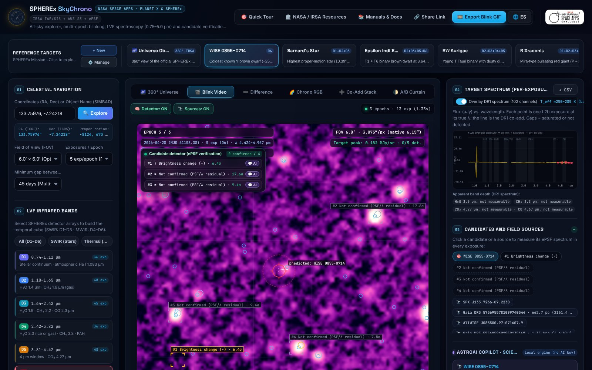
</p>
<p align="center"><em>Main workspace with WISE 0855−0714: reference targets, LVF detector bands, multi-epoch Blink viewer with the ePSF candidate detector, target spectrum and AstroAI Copilot. <a href="#-screenshots">More screenshots ↓</a></em></p>

---

## 🌌 Overview

**SPHEREx SkyChrono** is an open-source web application to explore the SPHEREx sky in time and in wavelength. It finds the Level-2 (L2b) exposures that cover any point of the sky and downloads only the cutouts it needs from AWS. It then alternates the visits (*blink*) to show what moves or changes brightness, and measures every source with the same method as the official pipeline: forced PSF photometry with the official ePSF.

**Rigor principle:** every number the app shows comes from an official product (SPHEREx at IRSA/AWS, Gaia DR3, AllWISE, SIMBAD) or from a documented calculation. When a value does not exist or is not reliable (saturation, low S/N, no parallax), the app says so instead of inventing it.

---

## 📸 Screenshots

All images were captured from the running application with live data from NASA/IPAC IRSA and the SPHEREx archive on AWS. The [User Guide](docs/SPHEREx_SkyChrono_User_Guide.md) explains each one step by step.

**Display modes** (Barnard's Star, the fastest-moving star in the sky)

<table>
  <tr>
    <td align="center" width="33%">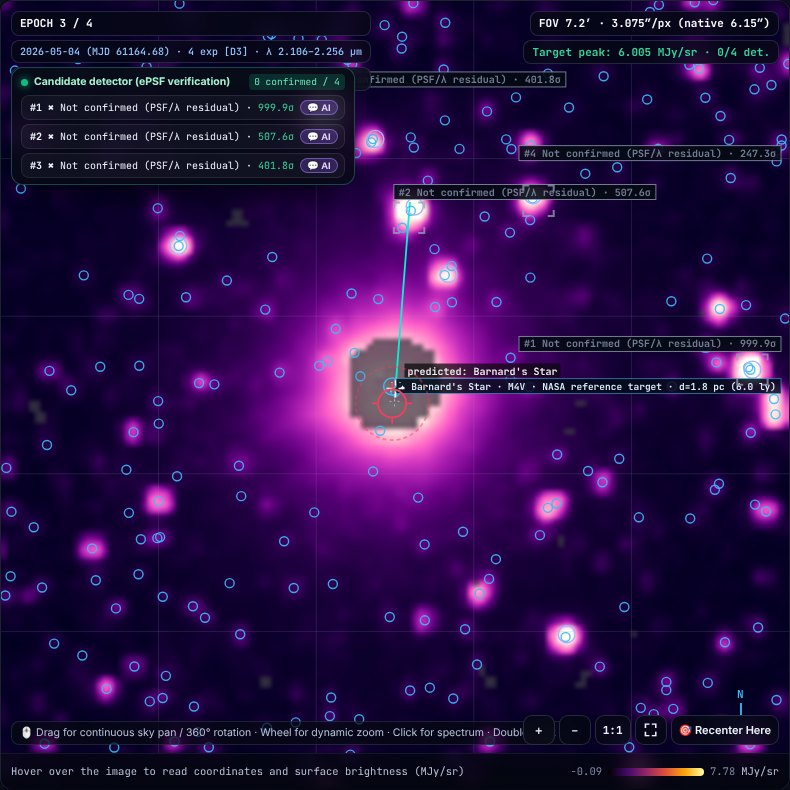<br><sub><b>Blink Video</b>: each frame is a real L2b visit; ✚ is the Gaia-predicted position</sub></td>
    <td align="center" width="33%">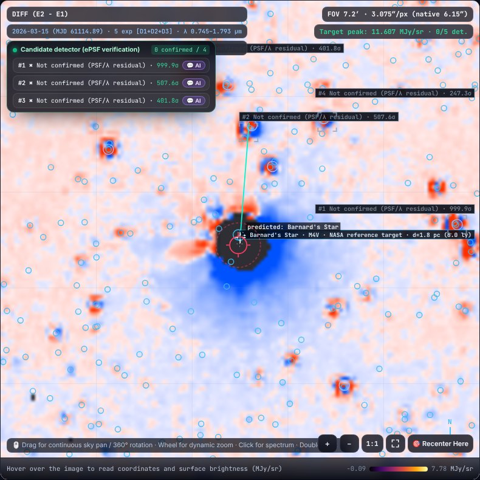<br><sub><b>Difference</b> (E2 − E1): residuals at the saturated star, which moved between visits</sub></td>
    <td align="center" width="33%">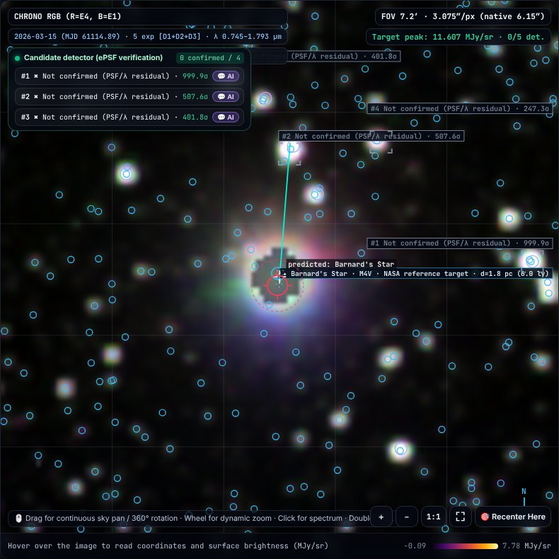<br><sub><b>Chronological RGB</b>: one epoch per colour channel</sub></td>
  </tr>
  <tr>
    <td align="center" width="33%">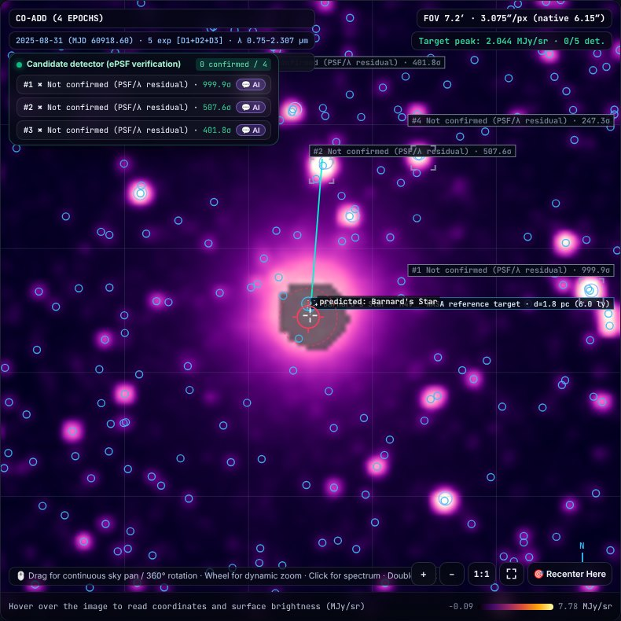<br><sub><b>Co-Add Stack</b>: compatible exposures combined</sub></td>
    <td align="center" width="33%">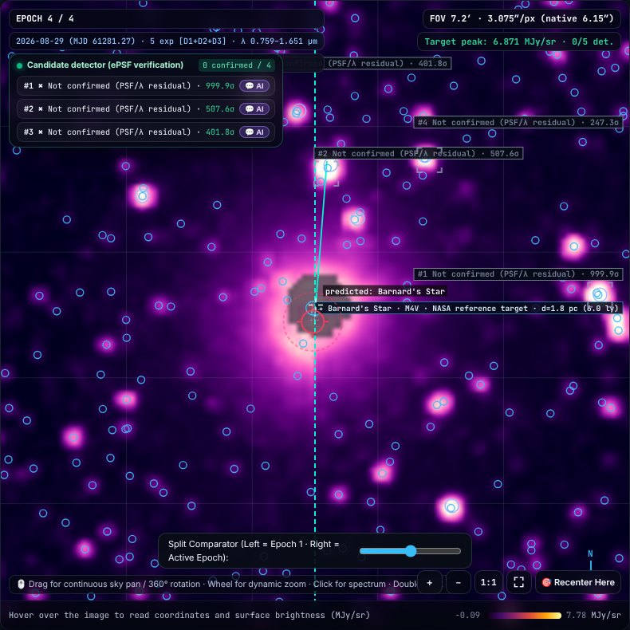<br><sub><b>A/B Curtain</b>: drag the divider to compare two epochs</sub></td>
    <td align="center" width="33%">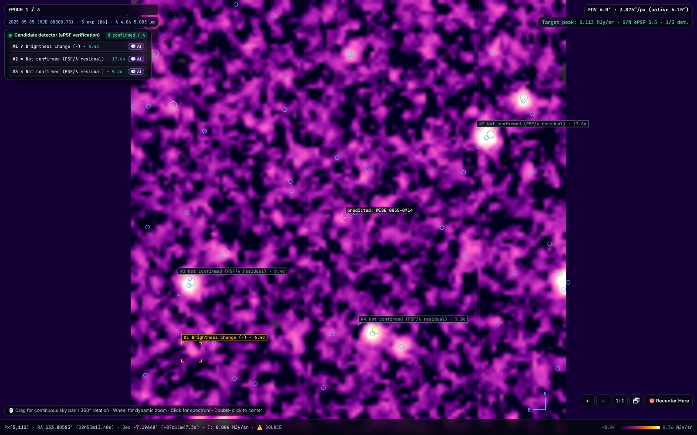<br><sub><b>Fullscreen viewer</b> (<code>F</code> key) on WISE 0855−0714</sub></td>
  </tr>
</table>

**Navigation, measurements and assistant** (Epsilon Indi Ba/Bb, a pair of T-type brown dwarfs)

<table>
  <tr>
    <td align="center" width="33%">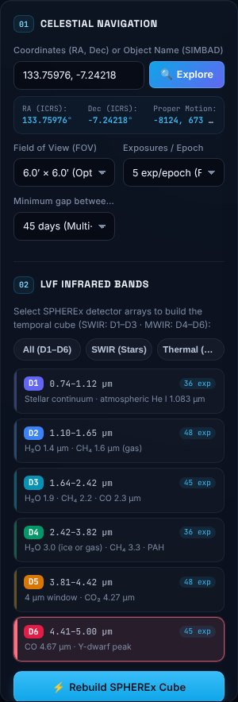<br><sub><b>Celestial Navigation</b>: search, FOV, exposures per epoch and D1–D6 bands</sub></td>
    <td align="center" width="33%">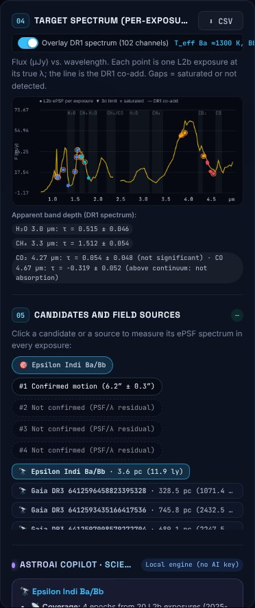<br><sub><b>Target Spectrum</b>: per-exposure ePSF fluxes over the DR1 spectrum, and band depths</sub></td>
    <td align="center" width="33%">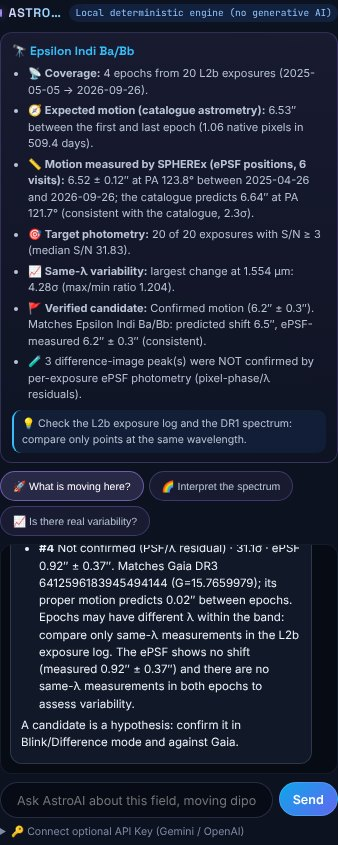<br><sub><b>AstroAI Copilot</b>: measured vs. predicted motion, local engine without API key</sub></td>
  </tr>
</table>

<table>
  <tr>
    <td align="center" width="50%">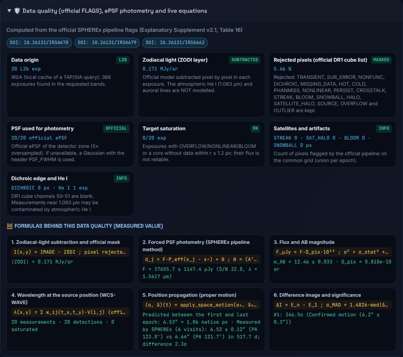<br><sub><b>Data Quality</b>: official FLAGS, ZODI, PSF, saturation and the formulas behind each value</sub></td>
    <td align="center" width="50%">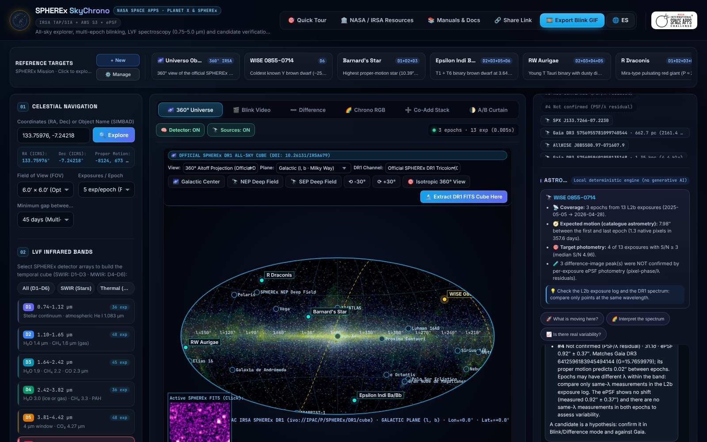<br><sub><b>360° Universe</b>: DR1 all-sky map for orientation; click to open a field</sub></td>
  </tr>
  <tr>
    <td align="center" width="100%" colspan="2">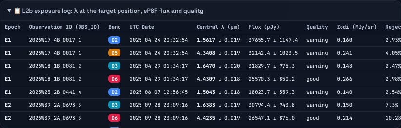<br><sub><b>L2b exposure log</b>: OBS_ID, detector, λ at the target, UTC date, ePSF flux, quality and subtracted ZODI for every exposure</sub></td>
  </tr>
  <tr>
    <td align="center" width="50%">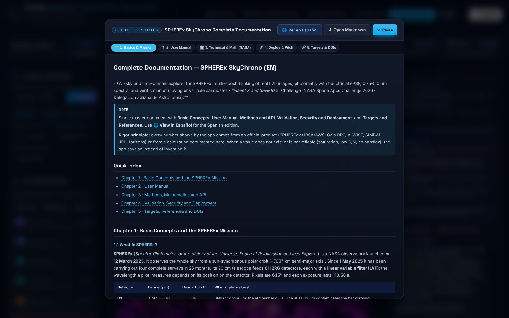<br><sub><b>Manuals &amp; Docs</b>: the complete documentation inside the app</sub></td>
    <td align="center" width="50%"><br><sub><b>NASA / IRSA Resources</b> with live links for the current coordinates</sub></td>
  </tr>
</table>

---

## ✨ What it does and with which data

| Module | What it shows | Method and source |
| :--- | :--- | :--- |
| **360° viewer** | All-sky map in Galactic, ecliptic and ICRS frames (Hammer-Aitoff 2:1, 3D globe, Aladin Lite) | Official HiPS PNGs of the DR1 All-Sky cube (visualisation only) |
| **Multi-epoch blink** | Real L2b exposures grouped by visit (up to 8 visits spread over the whole period): Blink, Difference, chronological RGB, Co-add and A/B Curtain | IRSA TAP → SIA → stored official list (challenge targets); HTTP Range cutouts from AWS S3 (IBE fallback) |
| **Fullscreen** | Fullscreen image viewer: **⛶** button, **F** key, **Esc** to exit | Fullscreen API; the image is always drawn with square pixels |
| **Target with proper motion** | ✚ predicted position of the target in each exposure | `SkyCoord.apply_space_motion` with Gaia DR3 or literature astrometry |
| **Photometry** | Flux in µJy with 1σ error, S/N, AB magnitude or 3σ upper limit | Official ePSF, least squares weighted by 1/VARIANCE, Gaia *deblending*, 3 % systematic, official mask |
| **Saturated stars** | Measured position even when the flux cannot be measured | Centroid of the core `OVERFLOW` pixels |
| **Measured motion** | Shift of the target between the first and last visit, against the predicted one, with the difference in σ | Weighted linear fit to the mean of each visit (standard error plus 0.7″ systematic for saturated cores) |
| **Candidates** | Dipoles and residuals of the difference image, each one verified | 5σ threshold with σ_MAD and ePSF verification: motion ≥ 3σ and ≥ 0.3 px; variability ≥ 5σ in the same channel in ≥ 2 independent pairs. Saturated measurements, detector-edge measurements and those outside the filter range do not count |
| **DR1 spectrum** | 102 channels at the target position, with saturation and neighbour warnings | Aperture photometry on the DR1 All-Sky cube (order-5 HEALPix tiles) |
| **Band depths** | τ of H₂O 3.0, CH₄ 3.3, CO₂ 4.27 and CO 4.67 µm, with error and interpretation (gas or ice) | Power-law continuum and a 0.04 systematic floor |
| **Field sources** | Gaia DR3 and AllWISE; distance only if π/σ ≥ 5 or a published distance exists | MAST with VizieR fallback; VizieR with IRSA Gator fallback |
| **Data quality** | Origin, zodiacal light subtracted, rejected pixels, PSF used, saturation and artefacts | Official `FLAGS` bits (Table 16 of the Explanatory Supplement) |
| **MPC report** | Draft in satellite format (two lines, code 288), only for confirmed motion without a stellar counterpart | Geocentric spacecraft vector `X/Y/Z_SC` interpolated to mid-exposure |
| **Copilot** | Answers based only on the measured telemetry, with rules against inventing values | Optional Gemini or OpenAI (**Confirm** button that checks the key and chooses the model; visible errors) or deterministic local engine |

---

## 🔬 Scientific safeguards

Working with SPHEREx data has well-known pitfalls. This is how SkyChrono handles each one:

| Pitfall | Why it matters | What SkyChrono does |
| :--- | :--- | :--- |
| Fixed catalogue coordinates for fast-moving stars | In 2026, WISE 0855, Barnard's Star and Eps Indi B are 125″, 103″ and 59″ away from their old catalogue positions | Gaia DR3 or literature astrometry, propagated to the date of each exposure |
| Treating the DR1 All-Sky Cube as a time series | It is a one-year co-add with no time information | It is shown as one labelled static image and never blinked |
| Trusting difference-image peaks | Sub-pixel phase, the different λ of each exposure, filter edges and the *blooming* of saturated stars produce false positives | Every candidate is verified with exposure-by-exposure ePSF photometry: confirmed, not confirmed (or saturated-star artefact) or not verifiable |
| Comparing fluxes measured at different wavelengths | Because of the LVF, each exposure sees the source at a different λ | Variability is only evaluated within the same DR1 channel, in at least two independent pairs |
| Measuring saturated stars | Their flux is meaningless and their blooming mimics motion | Flux is not reported; the position comes from the saturated core; blooming candidates are labelled as artefacts |
| Masking the wrong pixels | `SOURCE` (bit 21) marks catalogued stars, not bad pixels, and blooming depends on each star | Official `FLAGS` bits of Table 16 of the Explanatory Supplement, pixel by pixel; `SOURCE` is never masked |
| Approximate PSF photometry | A Gaussian is not the SPHEREx PSF, which is undersampled | Official ePSF, forced fit weighted by `VARIANCE`, with Gaia deblending (pipeline method, Supplement sec. 3.3) |
| HEALPix indexing errors | A wrong tile gives the spectrum of another part of the sky | Reference algorithm: 0 mismatches against `astropy-healpix` in 200,000 positions |
| Invented physical quantities | Distances, temperatures or "confidence" scores without a measurement behind them mislead | Distance only with a significant Gaia parallax (π/σ ≥ 5) or a published value; band depths with errors and a gas or ice interpretation by object type; quality panel built from real flag counts |
| Wrong MPC format | Ground-based codes and formats do not apply to a spacecraft | Observatory code **288** and the two-line satellite format with the spacecraft vector |
| Distorted images | Stretching the image changes angles and distances | Square pixels in the viewer and a true 2:1 Aitoff map |

---

## 🎯 Challenge reference targets

When a target is selected, the app centres the field on its **2026.0** position and predicts its position at the date of **each** exposure.

| Target | Astrometry (source) | What SPHEREx measures (real data) |
| :--- | :--- | :--- |
| **WISE 0855−0714** (Y dwarf, 2.28 pc) | Kirkpatrick et al. 2021: μ = (−8123.7, +673.2) mas/yr, ϖ = 439.0 mas | The coordinates in the challenge statement (`08h55m10.831s −7d14m42.53s`) are from the AllWISE epoch (2010.6); in 2026 the object is **~2.1′** away from them. In 19 L2b exposures at 4.4–5.0 µm (3 visits) it is detected in 9 (S/N ≈ 4; the best, 1.0 ± 0.2 mJy at 4.74 µm) at a median of 1.1″ from the predicted position. It passes 8″ from the star Gaia DR3 5756956644387831296 (G = 16.3), which the ePSF separates in L2b but which dominates the DR1 aperture below 3.5 µm. |
| **Barnard's Star** (M4V, 1.83 pc) | Gaia DR3: μ = (−801.6, +10362.4) mas/yr | **Saturated** in 28 of 28 L2b exposures and in 99 of 100 DR1 channels: the flux cannot be measured. The position can: the centroid of the saturated core falls 1.2″ (0.19 px) from the predicted position, and SPHEREx **measures a shift of 6.59 ± 1.00″ (PA 355°)** between 2025-08-25 and 2026-03-30, against 6.19″ (PA 356°) predicted by Gaia DR3 (0.4σ difference). |
| **Epsilon Indi Ba/Bb** (T1 + T6, 3.64 pc) | Gaia DR3: μ = (+3982.0, −2466.8) mas/yr | Detected in 32 of 32 L2b exposures (S/N ≈ 32) at a median of 0.0″ from the predicted position. SPHEREx **measures 6.88 ± 0.25″ (PA 122°)** in 519 days against 6.65″ (PA 122°) predicted (1.0σ), and the difference image flags it as *confirmed motion*. T-dwarf SED in DR1: 31 mJy (1.25 µm), 36 (1.66), 25 (2.19), 8 (3.29), 63 (4.0) and 18 mJy (4.6 µm); **τ(CH₄ 3.3 µm) = 1.51 ± 0.05** and τ(H₂O 3.0 µm) = 0.52 ± 0.05: gas absorption. |
| **RW Aurigae A** (T Tauri, 156 pc) | Gaia DR3 (2016.0) | **Saturated** in 24 of 24 L2b exposures and in 48 DR1 channels. Measured motion 0.56 ± 1.23″ in one year (consistent with zero, as expected). A false 9.5″ "motion" on its *blooming* is flagged as a saturated-star artefact. |
| **R Draconis** (Mira, P ≈ 245.6 d, ~800 pc) | Gaia DR3 (2016.0) | **Saturated** in 64 of 64 L2b exposures (8 visits, near the north ecliptic pole) and in all 100 DR1 channels. Measured motion 1.82 ± 0.83″ in 503 days (2.2σ, not significant). Its *blooming* artefacts are flagged as such. |

To repeat this validation (requires access to IRSA):

```bash
python tools/validate_targets.py
```
```bash
python tools/validate_targets.py WISE0855 Barnard --json report.json
```

---

## 🏗️ Architecture

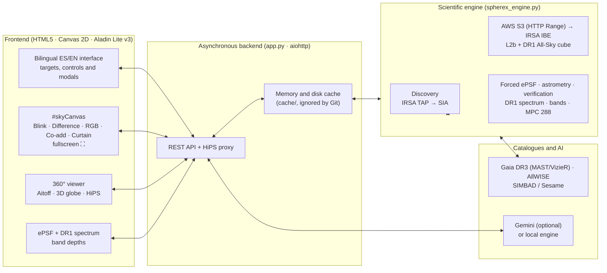

---

## 📁 Project structure

```text
NASA-SPACE-APPS-SPHEREX-ZULIA/
├── app.py                 # aiohttp server: REST API, HiPS proxy and optional pre-loading
├── spherex_engine.py      # Scientific engine: IRSA/S3, ePSF, astrometry, DR1, bands, MPC and copilot
├── requirements.txt       # Python dependencies
├── Dockerfile             # Docker image (Python 3.11, port 8050)
├── render.yaml            # Render deployment
├── .env.example           # Environment variable template (copy to .env)
├── .gitignore             # Excludes .env, cache/, *.fits, virtual environments
├── static/
│   ├── index.html         # Bilingual interface
│   ├── app.js             # Viewers, charts, fullscreen and UI logic
│   └── styles.css         # Styles
├── data/
│   └── spherex_exposure_index/  # Official exposure lists (IRSA SIA) for the 5 targets: fallback when IRSA does not respond
├── docs/
│   ├── SPHEREx_SkyChrono_Beginners_Guide.md    # Beginner's Guide (EN)
│   ├── SPHEREx_SkyChrono_User_Guide.md         # User Guide with screenshots (EN)
│   ├── SPHEREx_SkyChrono_Jury_Guide.md         # Technical and scientific Jury Guide (EN)
│   ├── SPHEREx_SkyChrono_Documentation_ES.md   # Complete documentation (5 chapters, ES)
│   ├── SPHEREx_SkyChrono_Documentation_EN.md   # Complete documentation (5 chapters, EN)
│   └── images/                                 # Screenshots used by the README and the guides
├── tests/
│   ├── test_science.py    # Offline tests: HEALPix, astrometry, bits, AB, MPC, τ, photometry and IRSA-less fallback
│   └── test_copilot.py    # Copilot with simulated providers: valid/invalid key, no quota, missing model
├── tools/
│   └── validate_targets.py  # Validation of the challenge targets with real SPHEREx data
```

---

## 🔌 REST API (`app.py`)

| Method | Route | Description |
| :--- | :--- | :--- |
| `GET` | `/` | Web interface |
| `GET · POST · DELETE` | `/api/targets` | Reference and custom targets (the official astrometry cannot be edited) |
| `GET` | `/api/resolve?q=` | Coordinates or name (Sesame/SIMBAD) propagated to 2026.0; recognises the old coordinates of the targets |
| `GET` | `/api/cube` | Multi-epoch cube: images, photometry, target track, measured motion, candidates and quality |
| `GET` | `/api/point_spectrum` | Per-exposure ePSF photometry at the chosen pixel |
| `GET` | `/api/dr1_spectrum` | 102-channel spectrum from the DR1 cube, band depths and warnings |
| `GET` | `/api/catalogs` | Gaia DR3 and AllWISE projected onto the field |
| `GET` | `/api/gif` | GIF animation of the epochs |
| `POST` | `/api/ai/chat` | Copilot |
| `POST` | `/api/ai/validate` | Checks an AI key with its provider (never returns it) |
| `GET` | `/api/ai/status` | Tells whether the server has a key in `.env` (without revealing it) |
| `GET` | `/api/docs?lang=es\|en` | Built-in documentation |
| `GET` | `/api/spherex-allsky-map` | Equirectangular map of the DR1 cube (visualisation) |
| `GET` | `/api/hips/spherex/{channel}/{path}` | HiPS proxy for Aladin Lite |
| `GET` | `/static/*`, `/docs/*` | Static files |

---

## 🚀 Quick start

### 1. Install dependencies
```bash
python -m venv .venv
```
```bash
source .venv/bin/activate
```
On Windows (PowerShell): `.\.venv\Scripts\Activate.ps1`
```bash
pip install -r requirements.txt
```

### 2. Optional configuration (`.env`)
The app works 100 % without keys: the copilot then uses its local engine. To use Gemini, copy the template and write your key in `.env`, which is never pushed to Git:
```bash
cp .env.example .env
```
Available variables: `GEMINI_API_KEY` or `OPENAI_API_KEY`, `GEMINI_MODEL` / `OPENAI_MODEL` (only to force a model; by default it is chosen automatically), `PORT`, `SPHEREX_TAP_TIMEOUT` (seconds, default 30), `SPHEREX_SIA_TIMEOUT` (default 60) and `SPHEREX_PREWARM=0` (disables pre-loading of the targets).

You can also use your key without `.env`: in the copilot panel open **🔑 Connect API Key**, paste it and press **Confirm**. The app checks it with Google or OpenAI and shows ✅ (connected, with the chosen model), ⚠️ (valid, but models overloaded or out of quota at that moment) or ❌ (rejected, with the reason). The key lives only in that browser tab; **Remove** deletes it.

### 3. Run
```bash
python app.py
```
Open `http://localhost:8050`.

### 4. Verify
```bash
python -m py_compile app.py spherex_engine.py
```
```bash
node --check static/app.js
```
```bash
python tests/test_science.py
```
```bash
python tests/test_copilot.py
```

### 5. Docker or Render
```bash
docker build -t spherex-skychrono .
```
```bash
docker run -p 8050:8050 spherex-skychrono
```
For Render, [`render.yaml`](render.yaml) is already configured; add `GEMINI_API_KEY` as a secret variable in the dashboard if you want to use Gemini.

---

## ⚠️ Known limitations

SkyChrono works with real SPHEREx data, which comes with some limitations worth knowing. Barnard's Star, RW Aurigae and R Draconis are so bright that they saturate the detectors, so their position is measured accurately but their flux is not reliable. At the opposite end, WISE 0855−0714 is a faint object for SPHEREx and is also blended with a G = 16.3 star only 8″ away, so its signal-to-noise ratio in each individual exposure is low.

As for data availability, IRSA is only needed to know which exposures cover a point of the sky, because the images are read directly from AWS S3. If IRSA's TAP and SIA services do not respond, the five challenge targets use their official list stored in `data/spherex_exposure_index/` and the blink keeps working normally. At any other point of the sky, if IRSA fails at that moment, the application shows a single static image from the DR1 cube, clearly labelled as such, and never simulates epochs. Meanwhile, it retries the connection about every minute, querying TAP and SIA at the same time and with retries. As soon as IRSA responds, any point of the sky shows all its epochs.

Finally, Planet X (or Planet Nine) is still a hypothetical object that has not been detected. At about 500 AU from the Sun it would move about 7″ per day, so it would have to be searched for within a single SPHEREx visit, which spans several days, and not by comparing visits six months apart. Nor is the DR1 cube suitable for that search: it has 12.9″ pixels, combines a whole year of observations with no time information, and its HiPS images are meant only for visualisation, not for scientific measurements.

---

## 📚 Documentation

| Document | For whom | Link |
| :--- | :--- | :--- |
| 🚀 **Beginner's Guide** | Anyone, no astronomy background needed | [docs/SPHEREx_SkyChrono_Beginners_Guide.md](docs/SPHEREx_SkyChrono_Beginners_Guide.md) |
| 📖 **User Guide** | Users who want every control and measurement explained, with screenshots | [docs/SPHEREx_SkyChrono_User_Guide.md](docs/SPHEREx_SkyChrono_User_Guide.md) |
| ⚖️ **Jury Guide** | Technical and scientific evaluators: methods, provenance, validation and limits | [docs/SPHEREx_SkyChrono_Jury_Guide.md](docs/SPHEREx_SkyChrono_Jury_Guide.md) |
| 🇺🇸 **Complete documentation** | Concepts, user manual, formulas, API, validation and references | [docs/SPHEREx_SkyChrono_Documentation_EN.md](docs/SPHEREx_SkyChrono_Documentation_EN.md) |
| 🇪🇸 **Documentación completa** | Same content in Spanish | [docs/SPHEREx_SkyChrono_Documentation_ES.md](docs/SPHEREx_SkyChrono_Documentation_ES.md) |

The complete documentation can also be read inside the app with **📚 Manuals & Docs**.

---

## 🔗 Official resources and credits

- SPHEREx archive at IRSA: https://irsa.ipac.caltech.edu/Missions/spherex.html
- Official SPHEREx tutorials: https://caltech-ipac.github.io/irsa-tutorials/spherex/
- Official IRSA tools: [SPHEREx Data Explorer](https://irsa.ipac.caltech.edu/applications/spherex) · [MOST](https://irsa.ipac.caltech.edu/applications/MOST) (SPHEREx images covering a Solar System object) · [Spectrophotometry Tool](https://irsa.ipac.caltech.edu/applications/spherex/tool-spectrophotometry)
- Canonical SPHEREx papers: Bock et al. 2026 (mission), Akeson et al. 2026 (pipeline), Korngut et al. 2026 (instrument and calibration), Crill et al. 2025 (sky simulator)
- Challenge resources: https://www.spaceappschallenge.org/2026/challenges/planet-x-and-spherex/?tab=resources
- Gaia DR3 at MAST: https://archive.stsci.edu/missions-and-data/gaia
- WiseView: http://byw.tools/wiseview
- MPC format for observations from satellites: https://www.minorplanetcenter.net/iau/info/SatelliteObs.html
- DOIs: [10.26131/IRSA678](https://doi.org/10.26131/IRSA678) (DR1 Spectral Images) · [10.26131/IRSA679](https://doi.org/10.26131/IRSA679) (DR1 All-Sky Cube) · [10.26131/IRSA662](https://doi.org/10.26131/IRSA662) (QR3) · [10.26131/IRSA554](https://doi.org/10.26131/IRSA554) (SPLICES)

> This publication makes use of data products from the Spectro-Photometer for the History of the Universe, Epoch of Reionization and Ices Explorer (SPHEREx), which is a joint project of the Jet Propulsion Laboratory and the California Institute of Technology, and is funded by the National Aeronautics and Space Administration.

NASA does not endorse any non-U.S. Government entity; data from external sites are used according to their own terms.

---

*Developed by **Stars Finders — Delegación Zuliana de Astronomía** (Jesús Durán, Alejandro Montiel, José Montiel and Jeshua Durán) for the **NASA Space Apps Challenge 2026**.*

**Use of AI in development:** the team used Antigravity (Argon) and Claude Opus as development assistants, mainly to generate base code that the team then integrated, to get advanced astronomy guidance, and to solve very complex debugging and advanced programming problems. They were a valuable support, not the authors of the project: the team defined the goals and scientific requirements, directed the development, reviewed and tested the results, and is responsible for every decision. No measurement shown by the application is produced by AI (details in the [Jury Guide](docs/SPHEREx_SkyChrono_Jury_Guide.md#8-use-of-artificial-intelligence)).
