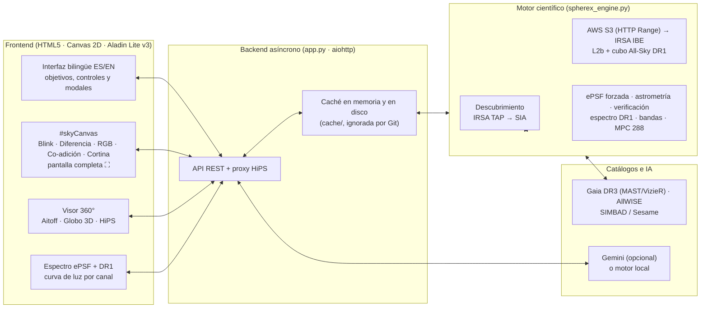

# SPHEREx SkyChrono

**Explorador de cielo completo y de series temporales para SPHEREx: blinking multi-época de imágenes L2b reales, fotometría con la ePSF oficial, espectros de 0.75–5.0 µm y verificación de candidatos en movimiento o variables.**

> **Reto oficial:** *Planet X and SPHEREx* — NASA Space Apps Challenge 2026
> **Equipo:** Delegación Zuliana de Astronomía
> **Datos:** NASA/IPAC IRSA (SPHEREx DR1 y QR3) · AWS Open Data (`s3://nasa-irsa-spherex/`) · Gaia DR3 (MAST) · AllWISE (VizieR / IRSA) · SIMBAD / Sesame · Minor Planet Center (SPHEREx = código **288**)

[](https://www.python.org/)
[](https://docs.aiohttp.org/)
[](https://www.astropy.org/)
[](https://irsa.ipac.caltech.edu/Missions/spherex.html)
[](https://doi.org/10.26131/IRSA678)
[](#-documentación)

---

## 🌌 Resumen

> **Equipo Stars Finders · Delegación Zuliana de Astronomía.** Interfaz v5: visor cuadrado sin deformación, paneles fijos, capas simplificadas y logos del equipo y de la NASA en la cabecera (detalle en la documentación, cap. 2.0).

**SPHEREx SkyChrono** es una aplicación web de código abierto para explorar el cielo de SPHEREx en el tiempo y en longitud de onda. Busca las exposiciones de nivel 2 (L2b) que cubren cualquier punto del cielo y descarga solo los recortes necesarios desde AWS. Después alterna las visitas (*blink*) para ver qué se mueve o cambia de brillo, y mide cada fuente con el mismo método del pipeline oficial: fotometría PSF forzada con la ePSF oficial.

**Principio de rigor:** todo número que muestra la app sale de un producto oficial (SPHEREx en IRSA/AWS, Gaia DR3, AllWISE, SIMBAD) o de un cálculo documentado. Cuando un dato no existe o no es fiable (saturación, baja S/N, sin paralaje), la app lo dice en lugar de inventarlo.

---

## ✨ Qué hace y con qué datos

| Módulo | Qué muestra | Método y fuente |
| :--- | :--- | :--- |
| **Visor 360°** | Mapa del cielo completo en planos galáctico, eclíptico e ICRS (Hammer-Aitoff 2:1, globo 3D, Aladin Lite) | PNG HiPS oficiales del cubo All-Sky DR1 (solo para visualizar) |
| **Blink multi-época** | Exposiciones L2b reales agrupadas por visita (hasta 8 visitas repartidas en todo el período): Blink, Diferencia, RGB cronológico, Co-adición y Cortina A/B | IRSA TAP → SIA → lista oficial guardada (objetivos del reto); recortes por HTTP Range desde AWS S3 (respaldo IBE) |
| **Pantalla completa** | Visor de imágenes a pantalla completa: botón **⛶**, tecla **F**, **Esc** para salir | Fullscreen API; la imagen se dibuja siempre con píxeles cuadrados |
| **Objetivo con movimiento propio** | ✚ posición predicha del objetivo en cada exposición | `SkyCoord.apply_space_motion` con astrometría Gaia DR3 o de la literatura |
| **Fotometría** | Flujo en µJy con error 1σ, S/N, magnitud AB o límite superior a 3σ | ePSF oficial, mínimos cuadrados con pesos 1/VARIANCE, *deblending* con Gaia, 3 % sistemático, máscara oficial |
| **Estrellas saturadas** | Posición medida aunque el flujo no sea medible | Centroide de los píxeles `OVERFLOW` del núcleo |
| **Movimiento medido** | Desplazamiento del objetivo entre la primera y la última visita, frente al predicho, con su diferencia en σ | Ajuste lineal ponderado a las medias de cada visita (error estándar más 0.7″ de sistemático para núcleos saturados) |
| **Candidatos** | Dipolos y residuos de la imagen de diferencia, cada uno verificado | Umbral 5σ con σ_MAD y verificación ePSF: movimiento ≥ 3σ y ≥ 0.3 px; variabilidad ≥ 5σ en el mismo canal en ≥ 2 pares independientes. No cuentan las mediciones saturadas, las del borde del detector ni las que quedan fuera del rango del filtro |
| **Espectro DR1** | 102 canales en la posición del objetivo, con avisos de saturación y de fuentes vecinas | Fotometría de apertura en el cubo All-Sky DR1 (teselas HEALPix de orden 5) |
| **Profundidad de bandas** | τ de H₂O 3.0, CH₄ 3.3, CO₂ 4.27 y CO 4.67 µm, con su error e interpretación (gas o hielo) | Continuo de ley de potencias y piso sistemático de 0.04 |
| **Fuentes del campo** | Gaia DR3 y AllWISE; distancia solo si π/σ ≥ 5 o hay una distancia publicada | MAST con respaldo VizieR; VizieR con respaldo IRSA Gator |
| **Calidad de datos** | Origen, luz zodiacal restada, píxeles rechazados, PSF usada, saturación y artefactos | Bits `FLAGS` oficiales (Tabla 16 del Suplemento Explicativo) |
| **Reporte MPC** | Borrador en formato de satélite (dos líneas, código 288), solo para movimiento confirmado sin contrapartida estelar | Vector geocéntrico de la nave `X/Y/Z_SC` interpolado a mitad de exposición |
| **Copiloto** | Respuestas basadas solo en la telemetría medida, con reglas contra inventar valores | Gemini u OpenAI opcional (botón **Confirmar** que comprueba la clave y elige el modelo; errores visibles) o motor local determinista |

---

## 🔬 Auditoría científica (v4.0): qué se corrigió o eliminó

| Antes | Problema | Ahora |
| :--- | :--- | :--- |
| Coordenadas fijas de WISE 0855, Barnard y Eps Indi B | En 2026 estaban a 125″, 103″ y 59″ de los objetos reales | Astrometría Gaia DR3 o de la literatura, propagada a la fecha de cada exposición |
| Guarda de *blooming* fija en (1648, 1752) de la banda 1 | Los datos reales no muestran un defecto fijo en esa posición; el *blooming* depende de cada estrella | Bit oficial `BLOOM` (26), píxel a píxel |
| Bits `FLAGS` que no existen en DR1 (p. ej. `PHANTOM`) | No están en la Tabla 16 oficial | Tabla 16 oficial; `SOURCE` (bit 21) nunca se enmascara |
| Código MPC `C59` y formato óptico terrestre | `C59` es el telescopio Yangwang-1, no SPHEREx | Código **288** y formato de satélite de dos líneas con el vector de la nave |
| Índice HEALPix NESTED con recorte | ~12 % del cielo apuntaba a la tesela equivocada | Algoritmo de referencia: 0 discrepancias frente a `astropy-healpix` en 200 000 posiciones |
| "Épocas" del cubo DR1 con fechas | El cubo DR1 es una co-adición de un año, sin información temporal | Una sola imagen estática, rotulada como tal, sin blink |
| Tipos espectrales y distancias generados por *hash*; distancias fotométricas | Datos inventados | Gaia DR3 y AllWISE; distancia solo con paralaje significativa |
| Teff por ley de Wien e "índice de hielos biogénicos" | Una enana marrón no es un cuerpo negro y sus bandas son de gas, no de hielo | Profundidad aparente con error y significancia, más una interpretación gas/hielo según el tipo de objeto |
| "% de confianza IA" y escudos "CLEAN" fijos | No se calculaban con los datos | Panel de calidad con conteos reales de bits y de saturación |
| "Fotometría Tractor exacta" con una gaussiana 15×15 | No era Tractor ni usaba la PSF real | ePSF oficial con ajuste forzado (método del pipeline, Suplemento sec. 3.3) |
| Candidatos de la diferencia presentados como detecciones | Falsos positivos por la fase subpíxel, la λ distinta de cada exposición, el borde del filtro y el *blooming* de estrellas saturadas | Verificación ePSF obligatoria: confirmado, no confirmado (o artefacto de estrella saturada) o no verificable |
| Elias 16 y 3I/ATLAS mal ubicados; "candidato a Planeta X" | Coordenadas erróneas o inventadas | Coordenadas de SIMBAD y JPL Horizons; el candidato ficticio se eliminó |
| Imagen estirada por CSS | Deformaba ángulos y distancias | Píxeles cuadrados y Aitoff con proporción 2:1 |

---

## 🎯 Objetivos de referencia del reto

Al elegir un objetivo, la app centra el campo en su posición de **2026.0** y predice su posición en la fecha de **cada** exposición.

| Objetivo | Astrometría (fuente) | Qué mide SPHEREx (datos reales) |
| :--- | :--- | :--- |
| **WISE 0855−0714** (enana Y, 2.28 pc) | Kirkpatrick et al. 2021: μ = (−8123.7, +673.2) mas/año, ϖ = 439.0 mas | Las coordenadas del enunciado (`08h55m10.831s −7d14m42.53s`) son de la época AllWISE (2010.6); en 2026 el objeto está a **~2.1′** de ellas. En 19 exposiciones L2b de 4.4–5.0 µm (3 visitas) se detecta en 9 (S/N ≈ 4; la mejor, 1.0 ± 0.2 mJy a 4.74 µm) a una mediana de 1.1″ de la posición predicha. Pasa a 8″ de la estrella Gaia DR3 5756956644387831296 (G = 16.3), que la ePSF separa en L2b pero que domina la apertura DR1 por debajo de 3.5 µm. |
| **Barnard's Star** (M4V, 1.83 pc) | Gaia DR3: μ = (−801.6, +10362.4) mas/año | **Saturada** en 28 de 28 exposiciones L2b y en 99 de 100 canales DR1: el flujo no es medible. La posición sí: el centroide del núcleo saturado cae a 1.2″ (0.19 px) de la posición predicha, y SPHEREx **mide un desplazamiento de 6.59 ± 1.00″ (AP 355°)** entre 2025-08-25 y 2026-03-30, frente a 6.19″ (AP 356°) predichos por Gaia DR3 (diferencia 0.4σ). |
| **Epsilon Indi Ba/Bb** (T1 + T6, 3.64 pc) | Gaia DR3: μ = (+3982.0, −2466.8) mas/año | Detectada en 32 de 32 exposiciones L2b (S/N ≈ 32) a una mediana de 0.0″ de la posición predicha. SPHEREx **mide 6.88 ± 0.25″ (AP 122°)** en 519 días frente a 6.65″ (AP 122°) predichos (1.0σ), y la imagen de diferencia la marca como *movimiento confirmado*. SED de enana T en DR1: 31 mJy (1.25 µm), 36 (1.66), 25 (2.19), 8 (3.29), 63 (4.0) y 18 mJy (4.6 µm); **τ(CH₄ 3.3 µm) = 1.51 ± 0.05** y τ(H₂O 3.0 µm) = 0.52 ± 0.05: absorción de gas. |
| **RW Aurigae A** (T Tauri, 156 pc) | Gaia DR3 (2016.0) | **Saturada** en 24 de 24 exposiciones L2b y en 48 canales DR1. Movimiento medido 0.56 ± 1.23″ en un año (compatible con cero, como se espera). Un falso "movimiento" de 9.5″ sobre su *blooming* queda marcado como artefacto de estrella saturada. |
| **R Draconis** (Mira, P ≈ 245.6 d, ~800 pc) | Gaia DR3 (2016.0) | **Saturada** en 64 de 64 exposiciones L2b (8 visitas, cerca del polo eclíptico norte) y en los 100 canales DR1. Movimiento medido 1.82 ± 0.83″ en 503 días (2.2σ, no significativo). Sus artefactos de *blooming* se marcan como tales. |

Para repetir esta validación (necesita acceso a IRSA):

```bash
python tools/validate_targets.py
```
```bash
python tools/validate_targets.py WISE0855 Barnard --json informe.json
```

---

## 🏗️ Arquitectura



---

## 📁 Estructura del proyecto

```text
NASA-SPACE-APPS-SPHEREX-ZULIA/
├── app.py                 # Servidor aiohttp: API REST, proxy HiPS y precarga opcional
├── spherex_engine.py      # Motor científico: IRSA/S3, ePSF, astrometría, DR1, bandas, MPC y copiloto
├── requirements.txt       # Dependencias de Python
├── Dockerfile             # Imagen Docker (Python 3.11, puerto 8050)
├── render.yaml            # Despliegue en Render
├── .env.example           # Plantilla de variables de entorno (copiar a .env)
├── .gitignore             # Excluye .env, cache/, *.fits, entornos virtuales
├── static/
│   ├── index.html         # Interfaz bilingüe
│   ├── app.js             # Visores, gráficos, pantalla completa y lógica de la UI
│   └── styles.css         # Estilos
├── data/
│   └── spherex_exposure_index/  # Listas oficiales de exposiciones (IRSA SIA) de los 5 objetivos: respaldo si IRSA no responde
├── docs/
│   ├── SPHEREx_SkyChrono_Documentation_ES.md   # Documentación completa (5 capítulos, ES)
│   └── SPHEREx_SkyChrono_Documentation_EN.md   # Complete documentation (5 chapters, EN)
├── tests/
│   ├── test_science.py    # Pruebas sin red: HEALPix, astrometría, bits, AB, MPC, τ, fotometría y respaldo sin IRSA
│   └── test_copilot.py    # Copiloto con proveedores simulados: clave válida/inválida, sin cuota, modelo inexistente
├── tools/
│   └── validate_targets.py  # Validación de los objetivos del reto con datos reales de SPHEREx
```

---

## 🔌 API REST (`app.py`)

| Método | Ruta | Descripción |
| :--- | :--- | :--- |
| `GET` | `/` | Interfaz web |
| `GET · POST · DELETE` | `/api/targets` | Objetivos de referencia y personalizados (la astrometría oficial no es editable) |
| `GET` | `/api/resolve?q=` | Coordenadas o nombre (Sesame/SIMBAD) propagados a 2026.0; reconoce las coordenadas antiguas de los objetivos |
| `GET` | `/api/cube` | Cubo multi-época: imágenes, fotometría, trayectoria del objetivo, movimiento medido, candidatos y calidad |
| `GET` | `/api/point_spectrum` | Fotometría ePSF por exposición en el píxel elegido |
| `GET` | `/api/dr1_spectrum` | Espectro de 102 canales del cubo DR1, profundidades de banda y avisos |
| `GET` | `/api/catalogs` | Gaia DR3 y AllWISE proyectados en el campo |
| `GET` | `/api/gif` | Animación GIF de las épocas |
| `POST` | `/api/ai/chat` | Copiloto |
| `POST` | `/api/ai/validate` | Comprueba una clave de IA con su proveedor (nunca la devuelve) |
| `GET` | `/api/ai/status` | Indica si el servidor tiene clave en `.env` (sin revelarla) |
| `GET` | `/api/docs?lang=es\|en` | Documentación integrada |
| `GET` | `/api/spherex-allsky-map` | Mapa equirectangular del cubo DR1 (visualización) |
| `GET` | `/api/hips/spherex/{canal}/{ruta}` | Proxy HiPS para Aladin Lite |
| `GET` | `/static/*`, `/docs/*` | Archivos estáticos |

---

## 🚀 Inicio rápido

### 1. Instalar dependencias
```bash
python -m venv .venv
```
```bash
source .venv/bin/activate
```
En Windows (PowerShell): `.\.venv\Scripts\Activate.ps1`
```bash
pip install -r requirements.txt
```

### 2. Configuración opcional (`.env`)
La app funciona al 100 % sin claves: el copiloto usa entonces su motor local. Para usar Gemini, copia la plantilla y escribe tu clave en `.env`, que nunca se sube a Git:
```bash
cp .env.example .env
```
Variables disponibles: `GEMINI_API_KEY` u `OPENAI_API_KEY`, `GEMINI_MODEL` / `OPENAI_MODEL` (solo para forzar un modelo; por defecto se elige solo), `PORT`, `SPHEREX_TAP_TIMEOUT` (segundos, por defecto 30), `SPHEREX_SIA_TIMEOUT` (por defecto 60) y `SPHEREX_PREWARM=0` (desactiva la precarga de los objetivos).

También puedes usar tu clave sin `.env`: en el panel del copiloto abre **🔑 Conectar API Key**, pégala y pulsa **Confirmar**. La app la comprueba con Google u OpenAI y muestra ✅ (conectada, con el modelo elegido), ⚠️ (válida, pero modelos saturados o sin cuota en ese momento) o ❌ (rechazada, con el motivo). La clave vive solo en esa pestaña del navegador; **Quitar** la borra.

### 3. Ejecutar
```bash
python app.py
```
Abre `http://localhost:8050`.

### 4. Verificar
```bash
python -m py_compile app.py spherex_engine.py
```
```bash
node --check static/app.js
```
```bash
python tests/test_science.py
```
```bash
python tests/test_copilot.py
```

### 5. Docker o Render
```bash
docker build -t spherex-skychrono .
```
```bash
docker run -p 8050:8050 spherex-skychrono
```
Para Render, [`render.yaml`](render.yaml) ya está configurado; añade `GEMINI_API_KEY` como variable secreta en el panel si quieres usar Gemini.

---

## ⚠️ Limitaciones conocidas

- **Saturación:** Barnard, RW Aur y R Dra saturan SPHEREx. Su posición se mide, pero su flujo no es fiable.
- **WISE 0855** es débil para SPHEREx y está mezclado con una estrella G = 16.3 a 8″: espera S/N bajo por exposición.
- **IRSA:** IRSA solo hace falta para saber qué exposiciones cubren un punto; las imágenes se leen de AWS S3. Si TAP y SIA no responden, los cinco objetivos del reto usan su lista oficial guardada en `data/spherex_exposure_index/` y el blink sigue funcionando. En cualquier otro punto, si IRSA no responde en ese momento, la app muestra una sola imagen estática del cubo DR1, claramente señalada, nunca simula épocas y reintenta IRSA automáticamente cada ~1 minuto (TAP y SIA se consultan a la vez, con reintentos). Cuando IRSA responde, cualquier punto muestra todas sus épocas.
- **Planeta X / Nueve** es hipotético y no se ha detectado. A ~500 UA se movería ~7″ por día: hay que buscarlo dentro de una misma visita (días), no entre visitas separadas seis meses.
- **Cubo DR1:** píxeles de 12.9″, sin información temporal. Sus PNG HiPS sirven solo para visualizar.

---

## 📚 Documentación

La documentación completa (conceptos, manual de usuario, métodos y fórmulas, validación y referencias) está en un solo documento por idioma. También se lee dentro de la app con **📚 Manuales y Docs**.

| Edición | Enlace |
| :--- | :--- |
| 🇪🇸 Español | [docs/SPHEREx_SkyChrono_Documentation_ES.md](docs/SPHEREx_SkyChrono_Documentation_ES.md) |
| 🇺🇸 English | [docs/SPHEREx_SkyChrono_Documentation_EN.md](docs/SPHEREx_SkyChrono_Documentation_EN.md) |

---

## 🔗 Recursos oficiales y créditos

- Archivo SPHEREx en IRSA: https://irsa.ipac.caltech.edu/Missions/spherex.html
- Tutoriales oficiales de SPHEREx: https://caltech-ipac.github.io/irsa-tutorials/spherex/
- Herramientas oficiales de IRSA: [SPHEREx Data Explorer](https://irsa.ipac.caltech.edu/applications/spherex) · [MOST](https://irsa.ipac.caltech.edu/applications/MOST) (imágenes de SPHEREx que cubren un objeto del Sistema Solar) · [Spectrophotometry Tool](https://irsa.ipac.caltech.edu/applications/spherex/tool-spectrophotometry)
- Artículos canónicos de SPHEREx: Bock et al. 2026 (misión), Akeson et al. 2026 (pipeline), Korngut et al. 2026 (instrumento y calibración), Crill et al. 2025 (simulador del cielo)
- Recursos del reto: https://www.spaceappschallenge.org/2026/challenges/planet-x-and-spherex/?tab=resources
- Gaia DR3 en MAST: https://archive.stsci.edu/missions-and-data/gaia
- WiseView: http://byw.tools/wiseview
- Formato MPC para observaciones desde satélites: https://www.minorplanetcenter.net/iau/info/SatelliteObs.html
- DOIs: [10.26131/IRSA678](https://doi.org/10.26131/IRSA678) (DR1 Spectral Images) · [10.26131/IRSA679](https://doi.org/10.26131/IRSA679) (DR1 All-Sky Cube) · [10.26131/IRSA662](https://doi.org/10.26131/IRSA662) (QR3) · [10.26131/IRSA554](https://doi.org/10.26131/IRSA554) (SPLICES)

> This publication makes use of data products from the Spectro-Photometer for the History of the Universe, Epoch of Reionization and Ices Explorer (SPHEREx), which is a joint project of the Jet Propulsion Laboratory and the California Institute of Technology, and is funded by the National Aeronautics and Space Administration.

NASA no respalda a entidades que no sean del Gobierno de EE. UU.; los datos de sitios externos se usan según sus propias condiciones.

---

*Desarrollado por la **Delegación Zuliana de Astronomía** para el **NASA Space Apps Challenge 2026**.*
