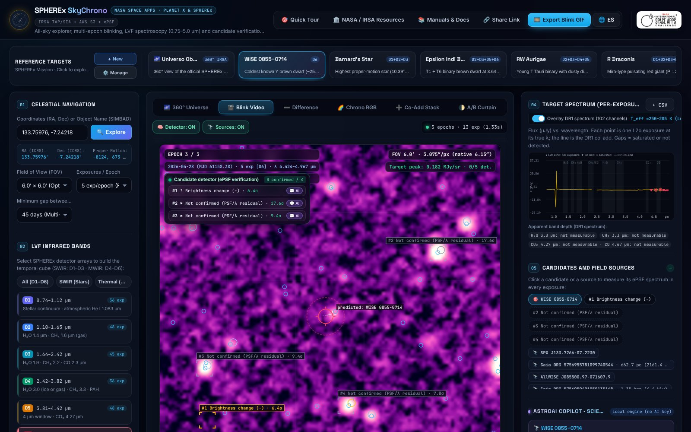
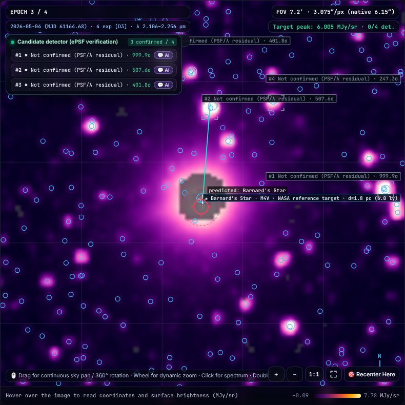
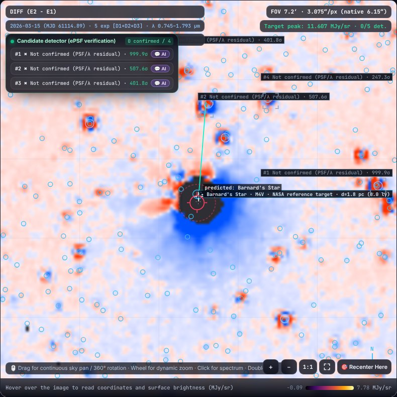
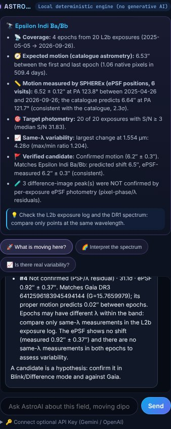
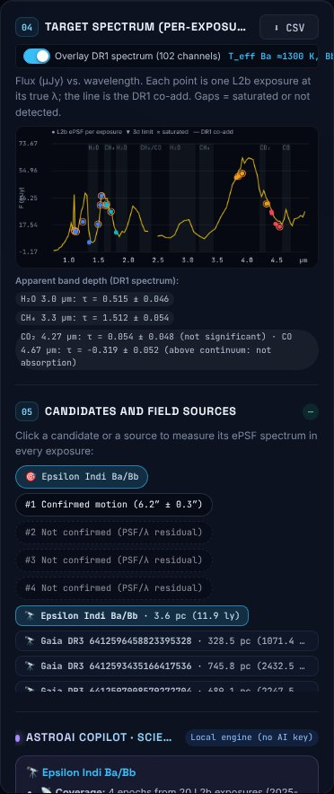
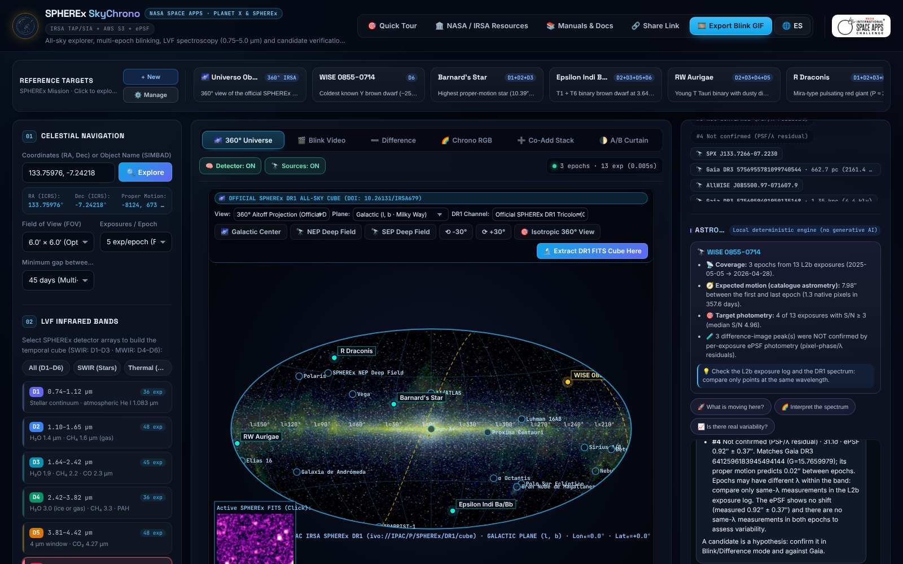

# SPHEREx SkyChrono
## Beginner's Guide
**NASA Space Apps Challenge 2026 — “Planet X and SPHEREx”**  
**Team:** Stars Finders — Delegación Zuliana de Astronomía

> **No astronomy background needed.** This guide gets you from zero to your first moving star in about ten minutes.
> When you want more detail, continue with the [User Guide](SPHEREx_SkyChrono_User_Guide.md). Evaluators can go to the [Jury Guide](SPHEREx_SkyChrono_Jury_Guide.md).

---

## 1. What is this app, in one minute?

**SPHEREx** is a NASA space telescope launched in March 2025. It photographs the whole sky in **infrared** light, which is invisible to our eyes. Each photo records a slightly different infrared colour (wavelength) at each position on the detector. SPHEREx comes back to the same part of the sky roughly every six months, so many places have several photos taken months apart.

**SPHEREx SkyChrono** lets you pick any point in the sky and see those photos one after another, like a short video. If something **moves** or **changes brightness** between the photos, you can see it, and the app then **measures** whether the change is real.

Everything you see comes from public NASA archives (NASA/IPAC IRSA and the SPHEREx archive on AWS) and well-known star catalogues (Gaia, AllWISE, SIMBAD). The app does not invent data: when something cannot be measured, it says so.

## 2. Six words you need

| Word | What it means in this app |
|---|---|
| **Epoch** | One visit of SPHEREx to a part of the sky. The app labels them E1, E2, E3… with their real dates. |
| **Blink** | Showing the epochs one after another, like a flip-book, so that changes jump out. |
| **Micrometre (µm)** | The unit for infrared wavelength. SPHEREx sees from 0.75 to 5.0 µm; visible light ends at about 0.7 µm. |
| **Proper motion** | How fast a star drifts across the sky over the years. Only very nearby stars move enough to notice. |
| **S/N (signal-to-noise)** | How clearly a source stands out from the noise. Below S/N = 3 the app does not count it as a detection. |
| **Saturated** | The star is so bright that it overflowed the detector pixels. Its position can still be measured, but its brightness cannot. |

## 3. Start the app

The app runs on your own computer. You need Python 3.11 or newer.

```bash
pip install -r requirements.txt
```
```bash
python app.py
```

Then open `http://localhost:8050` in your browser. No account or API key is needed. Use the **EN / ES** button in the header to switch the language.

<p align="center">
  
</p>
<p align="center"><em>The main screen: targets at the top, search and detector bands on the left, the image viewer in the centre, spectrum and assistant on the right.</em></p>

## 4. Your first moving star: Barnard's Star

Barnard's Star is the star with the fastest proper motion in the sky: it shifts about 10 arcseconds per year. SPHEREx can see it move between visits.

**Step 1. Choose the target.** In the **Reference Targets** strip at the top, click **Barnard's Star**. The app finds every SPHEREx photo of that spot and loads them. The first time this can take around half a minute.

**Step 2. Watch the blink.** The viewer starts in **Blink Video** mode. Look at the bright star in the centre and compare it with the stars around it: it jumps slightly from one epoch to the next while the others stay put. The ✚ marker shows where the Gaia catalogue predicts the star should be on the date of each photo.

<p align="center">
  
</p>
<p align="center"><em>Blink Video on Barnard's Star. The label at the top left shows which epoch you are seeing and its date.</em></p>

Useful controls: **Space** plays or pauses, the **← / →** keys move one epoch at a time, the mouse wheel zooms, and dragging the image moves around the sky. Press **F** for fullscreen and **Esc** to leave it.

**Step 3. Look at the difference.** Click **Difference**. This view subtracts the first epoch from the later one. A star that moved leaves a **pair of opposite residuals**, one red and one blue (called a *dipole*): one marks where it was and the other where it is now. Stars that did not move almost disappear.

<p align="center">
  
</p>
<p align="center"><em>Difference view: the red and blue residuals at Barnard's Star appear because it moved between the two visits. The app measures the motion itself from the star's position in each photo.</em></p>

**Step 4. Compare before and after.** Click **A/B Curtain** and drag the divider across the image to compare two epochs side by side.

**Step 5. Ask the assistant.** In the **AstroAI Copilot** panel on the right, click **🚀 What is moving here?** The assistant summarises what the app measured: the expected motion from the catalogue, the motion SPHEREx actually measured, and whether they agree. It works without any API key, using a local engine that only reports measured values.

<p align="center">
  
</p>
<p align="center"><em>The Copilot's answer for Epsilon Indi Ba/Bb: expected motion, measured motion and a verified candidate.</em></p>

**What you just saw:** Barnard's Star is *saturated* in SPHEREx, so the app does not give its brightness. It still measures its position from the saturated core, and the shift it measures agrees with the Gaia prediction. That is a real proper-motion measurement made with SPHEREx data.

## 5. Your second target: a pair of brown dwarfs

Brown dwarfs are objects too small to be stars and too large to be planets. They are cool, so they shine mostly in the infrared, which is exactly what SPHEREx sees.

1. Click **Epsilon Indi Ba/Bb** in the Reference Targets strip.
2. Watch the blink again: this pair also moves, and the app confirms its motion with its own measurements.
3. Look at the **Target Spectrum** panel on the right. Each dot is one SPHEREx photo measured at its own wavelength; the yellow line is the average spectrum from the SPHEREx all-sky map. The dips are caused by **methane** and **water** gas in the brown dwarfs' atmospheres.

<p align="center">
  
</p>
<p align="center"><em>Spectrum of Epsilon Indi Ba/Bb. Below the chart, the app estimates how deep each molecular band is.</em></p>

## 6. Explore on your own

- **Search anywhere:** type coordinates (for example `133.81891, -7.24705`) or an object name such as `Polaris` in **Celestial Navigation** and press **Explore**.
- **See the whole sky:** click **360° Universe** to see the SPHEREx all-sky map and click any point to open it.
- **Choose colours of infrared:** the detector cards D1–D6 select which wavelength range you look at. Cool objects such as brown dwarfs are easier to see in D5–D6 (long wavelengths).
- **Share what you find:** **Share Link** copies a link to the current view, and **Export Blink GIF** saves the animation.

<p align="center">
  
</p>
<p align="center"><em>The 360° Universe view, for finding your way around the sky.</em></p>

## 7. Four rules for reading the results

1. **A blink is a clue, not a proof.** Noise, very bright stars and the way SPHEREx samples each wavelength can make things look like they changed. The app checks every candidate with its own measurements and labels it ✔ confirmed, ✖ not confirmed or ? not verifiable.
2. **One image has no time.** If the app says it is showing a *static DR1* image, that place has no series of photos, so nothing about motion or brightness changes can be concluded there.
3. **Saturated means “too bright to weigh”.** The app gives the position of a saturated star but not its brightness.
4. **Planet X has not been found.** The app is a tool to look for and test candidates. It does not claim any discovery.

## 8. Where to go next

| If you want to… | Read |
|---|---|
| Learn every control and display mode | [User Guide](SPHEREx_SkyChrono_User_Guide.md) |
| Understand the methods, data provenance and validation | [Jury Guide](SPHEREx_SkyChrono_Jury_Guide.md) |
| See every formula, the API and the references | [Complete documentation (EN)](SPHEREx_SkyChrono_Documentation_EN.md) · [Documentación completa (ES)](SPHEREx_SkyChrono_Documentation_ES.md) |
| Install, run and test the project | [README](../README.md) |

---

**SPHEREx SkyChrono — Stars Finders, Delegación Zuliana de Astronomía**  
*Beginner's Guide · NASA Space Apps Challenge 2026*
