# SPHEREx SkyChrono
## User Guide
**NASA Space Apps Challenge 2026 — “Planet X and SPHEREx”**  
**Team:** Stars Finders — Delegación Zuliana de Astronomía

> **Companion documents:** [Beginner's Guide](SPHEREx_SkyChrono_Beginners_Guide.md) · [Jury Guide](SPHEREx_SkyChrono_Jury_Guide.md) · [Complete documentation (EN)](SPHEREx_SkyChrono_Documentation_EN.md) · [README](../README.md)
>
> Screenshots were taken from SPHEREx SkyChrono running locally with the English interface; every image and measurement shown was retrieved live from NASA/IPAC IRSA and the SPHEREx archive on AWS.

## Contents

- [1. Welcome to SPHEREx SkyChrono](#1-welcome-to-spherex-skychrono)
- [2. Before you begin](#2-before-you-begin)
- [3. Main interface](#3-main-interface)
- [4. Exploring the sky image](#4-exploring-the-sky-image)
- [5. Investigating a possible moving object](#5-investigating-a-possible-moving-object)
- [6. Examining spectra and brightness](#6-examining-spectra-and-brightness)
- [7. Zodiacal light and image quality](#7-zodiacal-light-and-image-quality)
- [8. Source detection and sub-pixel centring](#8-source-detection-and-sub-pixel-centring)
- [9. Reference layers and visual controls](#9-reference-layers-and-visual-controls)
- [10. Copilot / AI assistant](#10-copilot--ai-assistant)
- [11. Saving and returning to reference objects](#11-saving-and-returning-to-reference-objects)
- [12. Exporting and sharing results](#12-exporting-and-sharing-results)
- [13. Known limitations and responsible interpretation](#13-known-limitations-and-responsible-interpretation)
- [14. Suggested first investigation: WISE 0855−0714](#14-suggested-first-investigation-wise-08550714)
- [15. Scientific references and data acknowledgement](#15-scientific-references-and-data-acknowledgement)

---

## 1. Welcome to SPHEREx SkyChrono

SPHEREx SkyChrono is an interactive tool for exploring infrared observations from NASA’s SPHEREx mission. It is designed to help users inspect regions of the sky, compare observations from different dates, examine infrared spectra, and investigate possible moving or variable sources.

The application brings together sky navigation, multi-epoch image viewing, source measurements, catalogue information, data-quality checks, and an explanatory assistant. Its purpose is to support scientific exploration: a visual difference is a reason to investigate a source, not by itself proof that the source is moving or changing brightness.

**Important:** The application can display either real, time-resolved SPHEREx Level-2b (L2b) exposures or a static image from the DR1 All-Sky Cube. These products are not interchangeable. A static DR1 image has no time sequence and cannot establish motion or variability.

## 2. Before you begin

### 2.1 Coordinate system

The search box accepts **Right Ascension (RA)** and **Declination (Dec)** in decimal degrees or in sexagesimal format (for example `08h55m10.83s -07d14m42.5s`), or an object name resolved with SIMBAD/Sesame (for example `Barnard's Star` or `Polaris`).

- **Right Ascension (RA):** the east–west angular coordinate on the celestial sphere. It is commonly expressed in degrees or hours, minutes, and seconds.
- **Declination (Dec):** the north–south angular coordinate, expressed in degrees.
- **ICRS:** the International Celestial Reference System, the reference frame used by catalogues such as Gaia DR3 and SIMBAD.

For example, the coordinate pair `133.81891, -7.24705` represents an RA of 133.81891° and a Dec of −7.24705°. Always check the coordinate epoch when using published positions of high-proper-motion objects: the coordinates of WISE 0855−0714 in the challenge statement are from 2010.6, and by 2026 the object is about 2.1′ away from them. The reference targets in the app already account for this.

### 2.2 What is an epoch?

An **epoch** is an observation or group of observations associated with a particular time. SPHEREx revisits most of the sky about every six months, and more often near the ecliptic poles.

The application groups the exposures into visits by observation date and labels them E1, E2, E3, and so on. The real date of each visit is shown on the image. The number of visits depends on the sky position; the challenge targets have between 3 and 8.

### 2.3 What data are being displayed?

The application uses official SPHEREx data products, found through NASA/IPAC IRSA and read from the SPHEREx archive on AWS. It also uses Gaia DR3 and AllWISE to identify field sources and to predict positions.

Check the status indicator above the image viewer:

- **Multi-epoch L2b data** (for example “4 epochs · 20 exp”): individual calibrated exposures are available and can be compared over time.
- **Static DR1 (no L2b available):** only a combined all-sky image is available. It has no observation times, so it is useful for orientation and source inspection, not for a blink or a motion measurement. The app retries the archive automatically about once a minute.
- **Missing or unreliable measurements:** some exposures, channels or measurements can be missing, saturated, rejected or outside the usable detector range. The application flags these conditions and does not count them as valid detections.

## 3. Main interface

The workspace is organised into three main areas.

  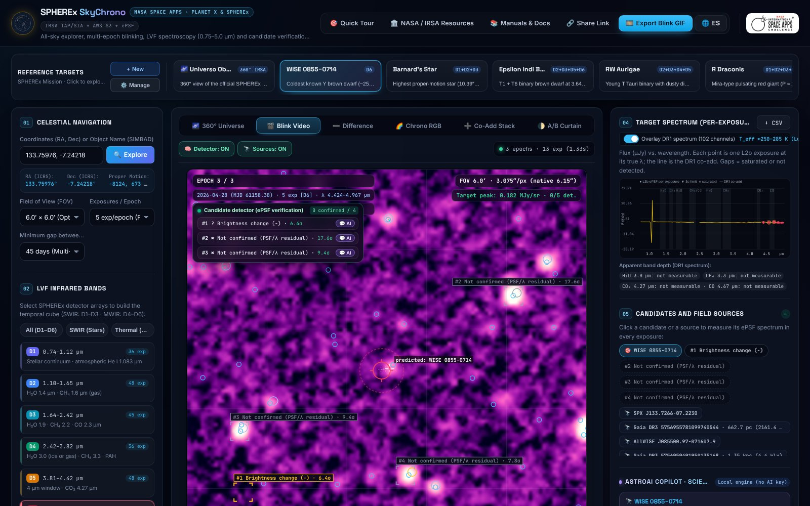

<em>Figure 1. Main workspace with WISE 0855−0714 loaded: header and Reference Targets strip (top), Celestial Navigation and LVF detector bands (left), Blink Video viewer with the candidate detector (centre), and the Target Spectrum, candidates and Copilot (right).</em>

### 3.1 Header and reference targets

The header contains **Quick Tour**, **NASA / IRSA Resources**, **Manuals & Docs**, **Share Link** and **Export Blink GIF**. The language button switches the interface between Spanish and English.

<table>
  <tr>
    <td width="50%" align="center">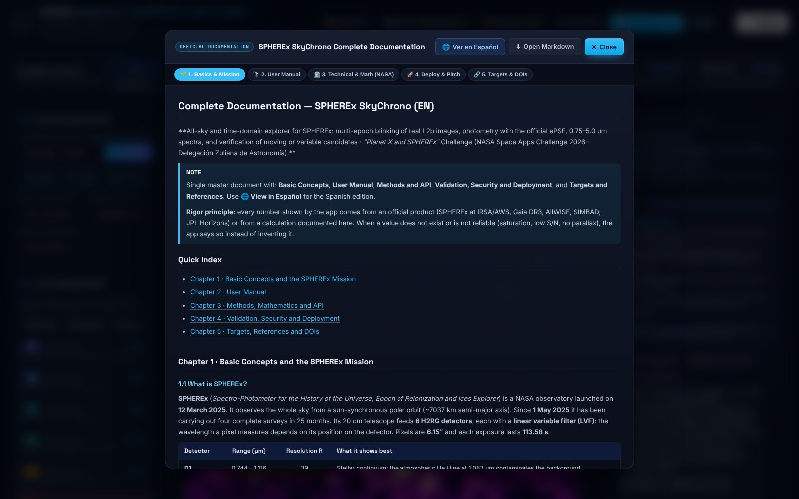 <em>Figure 2. <b>Manuals &amp; Docs</b>: the complete documentation opens inside the app.</em></td>
    <td width="50%" align="center">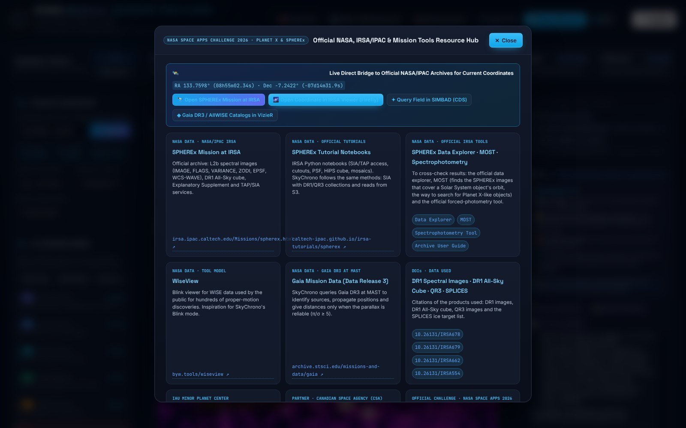 <em>Figure 3. <b>NASA / IRSA Resources</b>: official archives and tools with links for the current coordinates.</em></td>
  </tr>
</table>

The **Reference Targets** strip contains the challenge targets and a 360° view of the whole sky. Selecting a target centres the field on its position propagated to 2026.0, and the app predicts its position on the date of every exposure.

Reference targets include:

- **WISE 0855−0714:** a very cold Y-type brown dwarf with substantial proper motion.
- **Barnard’s Star:** a nearby star with very high proper motion.
- **Epsilon Indi Ba/Bb:** a nearby brown-dwarf pair.
- **RW Aurigae:** a young stellar system.
- **R Draconis:** a Mira-type variable star.

Being in this list does not make a target measurable everywhere. Barnard's Star, RW Aurigae and R Draconis are saturated in SPHEREx, so their positions are measured but their fluxes are not.

### 3.2 Left panel — Celestial Navigation

Use this panel to choose the sky position and configure the image data.

  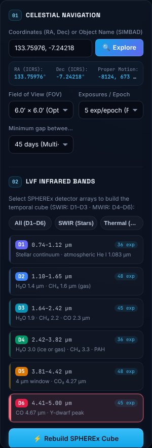

<em>Figure 4. Celestial Navigation: coordinate or object-name search with the resolved ICRS position, FOV, exposures per epoch, minimum gap between visits, and the D1–D6 detector cards with their exposure counts.</em>

**Search by coordinates or object name**

1. Enter RA and Dec, or enter a recognised object name.
2. Select **Explore**.
3. Check the resolved coordinates shown below the search field.
4. Inspect the field before interpreting any candidate.

When the pointer is over the image, the readout below the viewer shows the sky coordinates and the surface brightness under the cursor.

**Field of View (FOV)**

The FOV sets the angular size of the displayed sky region. A smaller FOV provides a closer view; a larger FOV provides more surrounding context. The display scale and the native SPHEREx pixel scale are shown in the viewer (for example “FOV 6.0′ · 3.075″/px (native 6.15″)”).

**Exposures per epoch**

This setting (5 to 20) controls how many exposures are requested for each visit when you load a field. More exposures give a more complete view of each visit but take longer to load. When you drag or zoom, the app requests 3 exposures per epoch so that neighbouring fields appear sooner.

**Minimum gap between visits**

This setting (15 to 90 days) decides when two exposures belong to different visits. It only groups the data; it does not assume that every region is observed on a fixed schedule.

### 3.3 Infrared detector bands

SPHEREx uses six detector arrays with linear variable filters. Together, they cover approximately 0.75–5.0 µm. The wavelength measured depends on the position of the source on the detector.

| Detector | Approximate wavelength range | Examples of useful spectral features |
|---|---:|---|
| D1 | 0.744–1.116 µm | Stellar continuum; the He I 1.083 µm region can be affected by atmospheric emission |
| D2 | 1.099–1.651 µm | H₂O near 1.4 µm and CH₄ near 1.6 µm |
| D3 | 1.636–2.421 µm | H₂O near 1.9 µm, CH₄ near 2.2 µm, and CO near 2.3 µm |
| D4 | 2.423–3.822 µm | H₂O around 2.7–3.1 µm, CH₄ near 3.3 µm, and PAH emission near 3.29 µm |
| D5 | 3.809–4.420 µm | The 4 µm window and CO₂ near 4.27 µm |
| D6 | 4.412–5.002 µm | CO near 4.67 µm and emission from some very cool brown dwarfs |

Use **All (D1–D6)**, **SWIR (Stars)** or **Thermal** to select groups of detectors, or click individual detector cards. Each card shows its wavelength interval and the number of exposures found for the field. Press **Rebuild SPHEREx Cube** to load the new selection.

The six detectors do not all measure the same wavelength. Combining their measurements provides broader spectral coverage; it should not be interpreted as automatically improving the signal-to-noise ratio at every wavelength.

## 4. Exploring the sky image

### 4.1 The 360° Universe view

The **360° Universe** view shows the SPHEREx all-sky map for orientation. It offers a Hammer-Aitoff projection, a 3D globe and Aladin Lite (HiPS), in Galactic, ecliptic or equatorial (ICRS) coordinates.

The all-sky DR1 visualisation is intended for orientation. Its display stretch and pixel scale are not a substitute for calibrated measurements from individual L2b exposures.

Double-click any point to open the multi-epoch exposures of that area in the detailed image viewer.

  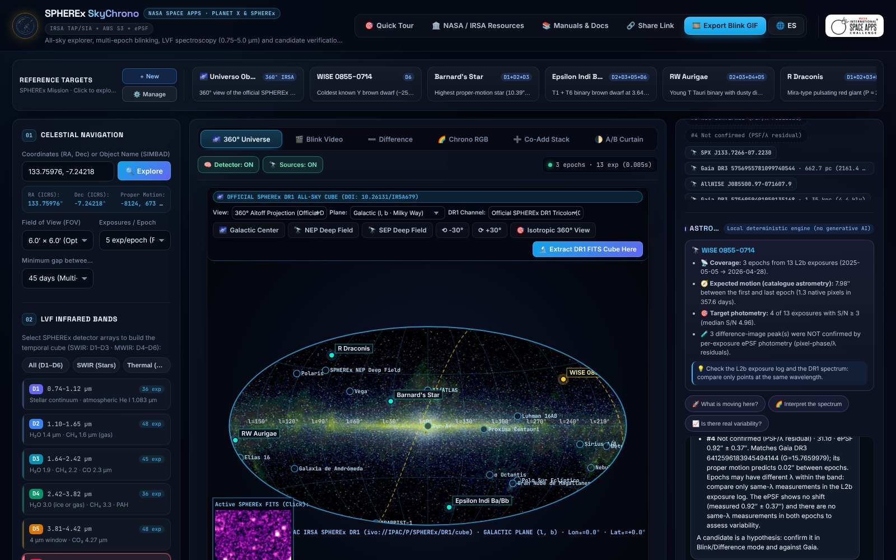

<em>Figure 5. <b>360° Universe</b> view: DR1 all-sky projection used for orientation; selecting a position opens that field in the detailed viewer.</em>

### 4.2 Image navigation

The detailed viewer supports the following interactions:

- **Drag:** pan across the sky; when you release, the neighbouring field loads with all its epochs.
- **Mouse wheel:** zoom around the pointer position.
- **Click:** inspect or measure the source under the pointer.
- **Double-click:** centre the viewer on the selected position.
- **＋ / －:** increase or decrease magnification.
- **1:1:** reset the zoom.
- **Fullscreen:** the ⛶ button or the `F` key.
- **Space:** play or pause the epoch sequence.
- **Left / Right arrows:** move to the previous or next epoch.
- **Esc:** leave fullscreen mode.
- **Recenter Here:** load a new SPHEREx cube centred on the current view.
- **Cadence:** slider that sets the blink speed.

The coordinate display and image status are useful checks that the intended field is being inspected.

  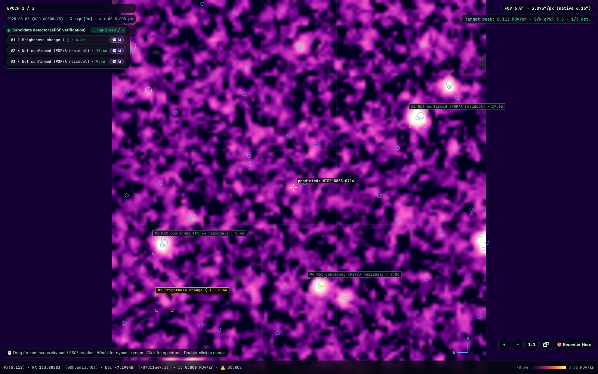

<em>Figure 6. Fullscreen viewer (<code>F</code> key) on the WISE 0855−0714 field, with the epoch label, FOV and pixel scale, candidate list and predicted-position marker.</em>

### 4.3 Image display modes

The central viewer offers several ways to inspect the data:

**Blink Video**

Plays the available epochs in sequence. This is the primary visual method for looking for a positional shift or a brightness change. A blinking appearance alone is not sufficient evidence of motion: noise, undersampling, saturation, blending, and changes in image quality can also produce apparent differences.

  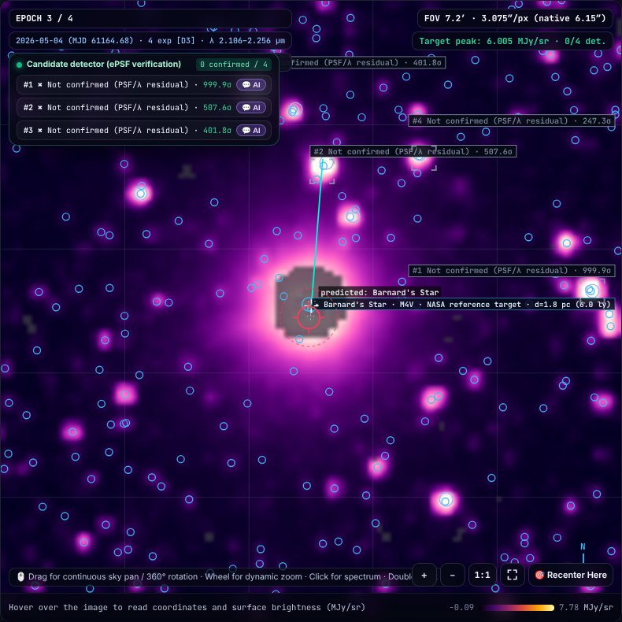

<em>Figure 7. <b>Blink Video</b> on Barnard’s Star: each frame is one real L2b visit; the marker shows the catalogue position propagated to the date of that visit.</em>

**Difference**

Displays the difference between the current epoch and the first one ($E_n - E_1$). A moving source may produce a positive–negative residual, often described as a dipole. A source whose brightness changes while its position remains fixed may leave a residual at approximately the same location.

Difference images are candidate-finding aids. The application uses exposure-level measurements to test whether a candidate is consistent with real motion or variability.

  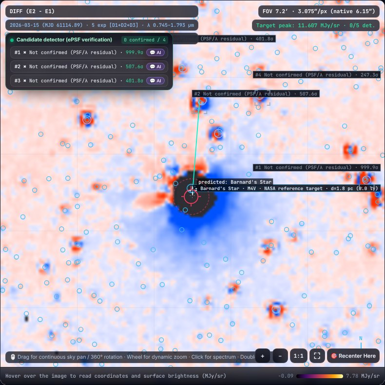

<em>Figure 8. <b>Difference</b> (E2 − E1) on Barnard’s Star: positive and negative residuals appear at the star because it moved between the two visits. Because the star is saturated, the application measures its motion from the saturated-core centroid in each exposure, not from this image.</em>

**Chronological RGB**

Maps the epochs to colour channels (R = last epoch, B = first epoch) to make changes easier to see. The colour is a visual encoding, not the object's natural colour or a direct chemical classification. Check the mode's on-screen legend before interpreting the colours.

  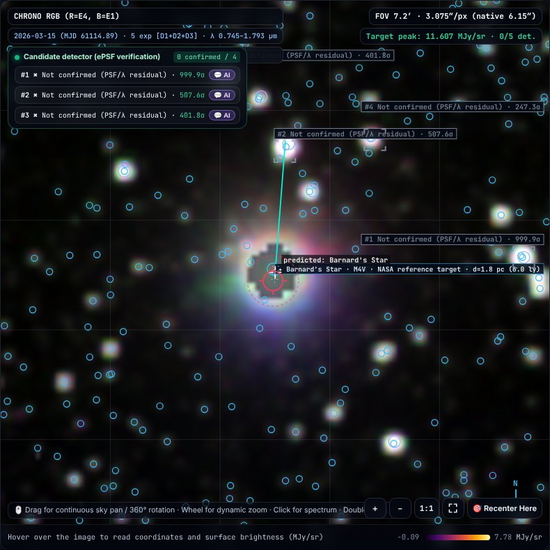

<em>Figure 9. <b>Chronological RGB</b> on Barnard’s Star: one epoch per colour channel; sources that do not change appear neutral, changes between epochs appear coloured.</em>

**Co-add**

Combines compatible observations to improve the visibility of persistent sources. A co-add is useful for detecting faint or stable objects, but it can suppress time information and may blur or dilute a moving source.

  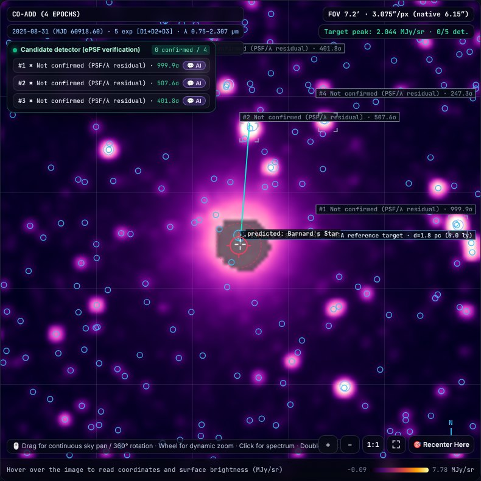

<em>Figure 10. <b>Co-Add Stack</b>: compatible exposures combined to reinforce persistent sources; time information is suppressed.</em>

**A/B Curtain**

Provides a before-and-after comparison. Move the divider to compare the selected epochs on either side of the curtain. This is useful for inspecting a suspected displacement or a change in the surrounding image.

  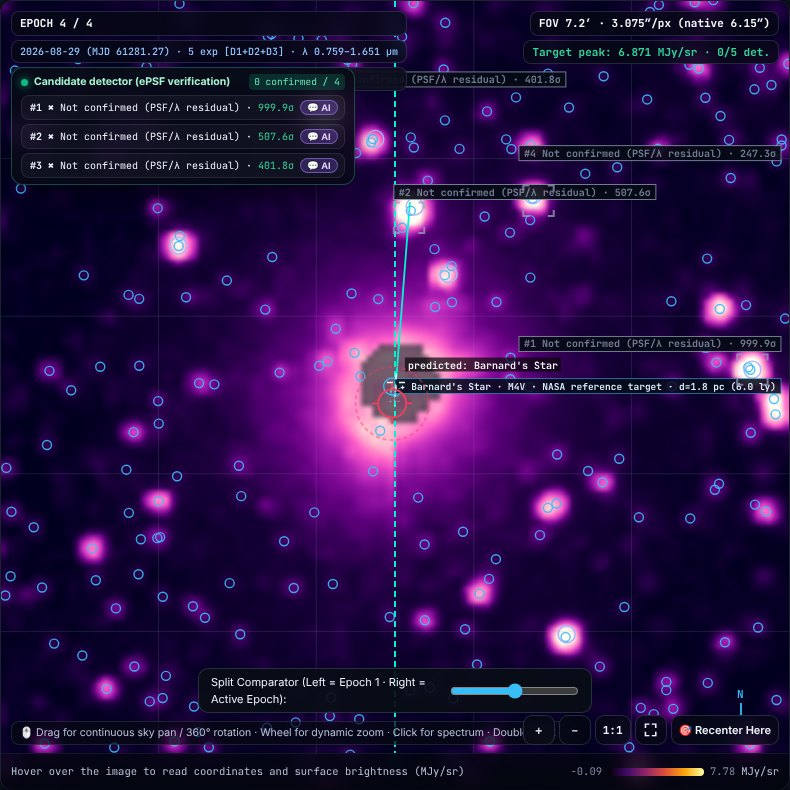

<em>Figure 11. <b>A/B Curtain</b>: drag the divider to compare two epochs of the same field side by side.</em>

## 5. Investigating a possible moving object

Use the following workflow to reduce false detections.

1. **Choose a field.** Search by coordinates or object name, or select a reference target.
2. **Confirm the data type.** Check that the viewer has real L2b exposures from more than one visit. A static DR1 co-add cannot support a time-domain motion claim.
3. **Select suitable detectors.** Use the detector range in which the source is expected to be detectable. Very faint sources may only be visible in part of the 0.75–5.0 µm range.
4. **Play the blink sequence.** Look for a consistent positional change relative to nearby field sources.
5. **Inspect the difference view.** A dipole can indicate a displacement, but can also be produced by artefacts or imperfect image matching.
6. **Check the predicted position.** For catalogue objects, the ✚ marker shows the reference position propagated to the date of each exposure.
7. **Inspect the candidate measurement.** Click the candidate in **Candidates and Field Sources** to see its ePSF measurement in every exposure.
8. **Read the data-quality warnings.** Check saturation, rejected pixels, blending, detector-edge warnings, and other flags before drawing a conclusion.

### 5.1 Proper motion

**Proper motion** is the apparent angular change in an object's position on the celestial sphere over time, caused primarily by its motion relative to the Solar System. It is commonly expressed in milliarcseconds per year (mas/yr) or arcseconds per year (arcsec/yr).

The application compares the measured displacement between visits with the displacement predicted from catalogue astrometry. The displayed value should be interpreted together with its uncertainty, time baseline, and data-quality status.

A source that appears to move by a few pixels in a difference image is not automatically a confirmed moving object. Confirmation requires a statistically significant centroid shift and sufficient displacement under the application's verification criteria.

### 5.2 Candidate status

The application labels every candidate as ✔ confirmed, ✖ not confirmed or ? not verifiable. A candidate can remain unverified when the signal is too weak, measurements are saturated, or usable data are missing.

Motion is confirmed only when the first-to-last epoch centroid shift is at least 3σ and at least 0.3 native pixels. Variability is confirmed only when the flux changes by at least 5σ in the same spectral channel, in at least two independent pairs of measurements. Saturated measurements do not count as ordinary flux detections; saturation-related structures can mimic motion.

## 6. Examining spectra and brightness

### 6.1 Target Spectrum panel

The right-hand panel displays measurements for the selected target or field source.

- **Horizontal axis:** wavelength, in micrometres (µm).
- **Vertical axis:** measured flux, in microjanskys (µJy).
- **Individual points:** exposure-level L2b measurements, measured at the wavelength corresponding to the source's detector position.
- **Uncertainty:** each point carries its 1σ error bar.
- **Upper limit (▼):** indicates that the source was not detected above the adopted threshold; it is not a measured flux.
- **Saturated (×):** indicates that a measurement is saturated and its flux should not be treated as reliable.
- **DR1 spectrum (yellow line):** switch on **Overlay DR1 spectrum (102 channels)** to show the co-added spectrum at the same position as a broader reference. It is not a time-resolved spectrum.

The **CSV** button exports the displayed spectrum.

  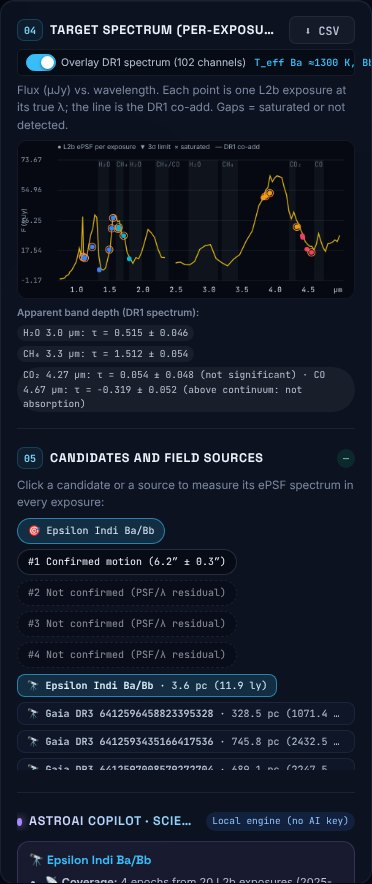

<em>Figure 12. Target Spectrum of Epsilon Indi Ba/Bb: exposure-level ePSF fluxes (points) over the DR1 102-channel spectrum (line), the apparent band depths, and the list of candidates and field sources.</em>

  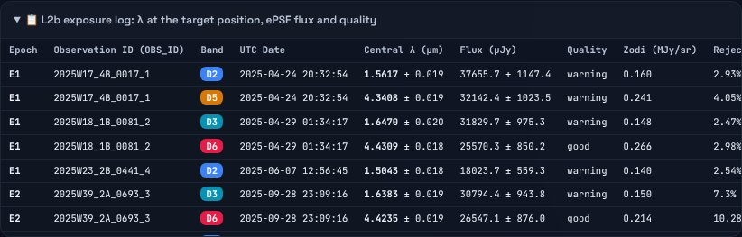

<em>Figure 13. <b>L2b exposure log</b>: for every exposure, the detector, central wavelength at the target position, ePSF flux, quality and subtracted zodiacal light. Compare brightness only between rows at the same or similar wavelength.</em>

### 6.2 Flux and microjanskys

**Flux density** describes how much energy from a source is received per unit area, time, and frequency interval. The application reports point-source measurements in microjanskys (µJy).

A larger flux generally means a brighter source at that wavelength. Flux values from different wavelengths should not be compared as though they were measurements in the same filter: the wavelength and detector response matter.

### 6.3 Signal-to-noise ratio (S/N or SNR)

The **signal-to-noise ratio** compares the measured signal with its uncertainty:

$$
\mathrm{S/N} = \frac{F}{\sigma_F}
$$

where $F$ is the measured flux and $\sigma_F$ is its uncertainty.

A higher S/N generally indicates a more reliable measurement. In this application, measurements below S/N = 3 are reported as 3σ upper limits rather than as detections. A low S/N point should not be interpreted as a secure spectral feature.

### 6.4 Apparent magnitude

When a valid flux detection is available, the application can express brightness as an AB apparent magnitude:

$$
m_{\mathrm{AB}} = 23.9 - 2.5\log_{10}(F_{\mu\mathrm{Jy}})
$$

Smaller magnitudes correspond to brighter sources. Magnitudes are not reported as detections when the flux is only an upper limit or is invalidated by saturation.

**Absolute magnitude** is the magnitude an object would have at a standard distance of 10 parsecs. It requires a reliable distance as well as a valid apparent magnitude. The application does not compute absolute magnitudes. It shows a distance only when the Gaia parallax is significant ($\varpi/\sigma_\varpi \ge 5$) or a published distance exists.

### 6.5 Spectral features and molecular interpretation

SPHEREx spectra can show absorption or emission associated with molecules such as H₂O, CH₄, CO₂, and CO. Below the chart, the application gives the apparent depth τ of four bands (H₂O 3.0, CH₄ 3.3, CO₂ 4.27 and CO 4.67 µm) on the DR1 spectrum, with its error and significance.

A spectral feature is evidence to interpret, not a complete chemical analysis. In cool brown-dwarf atmospheres, these features can be associated with gases. In dusty environments, similar molecular species can occur as ices on grains. The physical context of the target matters: the application never labels a brown-dwarf atmospheric feature as ice just because the molecule is also found in icy environments.

A band depth marked **not measurable** means the available spectral sampling or data quality is insufficient for a defensible estimate. A band marked **above continuum** lies above the fitted continuum (for example the 4 µm peak of T dwarfs) and is not an absorption.

## 7. Zodiacal light and image quality

### 7.1 Zodiacal light (ZODI)

Zodiacal light is infrared emission from interplanetary dust in the Solar System. It contributes diffuse foreground brightness to infrared observations.

The L2b product includes a zodiacal-light model in the `ZODI` layer. The application forms a cleaned image by subtracting this model from the `IMAGE` layer:

$$
I_{\mathrm{clean}} = \mathrm{IMAGE} - \mathrm{ZODI}
$$

The Data Quality panel and the L2b exposure log show the subtracted value, in MJy/sr.

### 7.2 MJy/sr

The unit **MJy/sr** means megajanskys per steradian. It is a unit of surface brightness: the flux density received per unit solid angle on the sky. It is therefore different from the point-source flux unit µJy.

Use MJy/sr to understand the brightness of extended image emission or the pixel intensity scale. Use µJy for the point-source flux measurements in the spectrum panel.

### 7.3 Data-quality flags

SPHEREx image products contain pixel-level flags. These identify conditions that can make a pixel unsuitable for display or measurement, including missing data, detector defects, transient artefacts, saturation-related effects, and other pipeline conditions.

The **Data Quality** panel summarises the current field:

- whether the displayed data are L2b exposures or a static DR1 image;
- whether zodiacal light has been subtracted;
- rejected-pixel information;
- the point-spread function (PSF) used for photometry;
- target saturation;
- artefacts such as streaks, satellite halos, blooming, or snowballs;
- warnings near detector boundaries or problematic wavelength regions.

A flag is not simply a visual decoration. Read its meaning before accepting a measurement. In particular, a pixel flagged `SOURCE` (bit 21) only belongs to a catalogued source and is never treated as a bad pixel.

  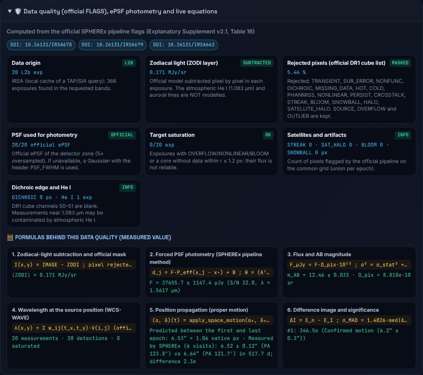

<em>Figure 14. <b>Data Quality</b>: data origin, zodiacal light subtracted, rejected pixels from the official FLAGS, PSF used for photometry, target saturation, artefacts and detector-edge warnings, followed by the formulas behind each value.</em>

## 8. Source detection and sub-pixel centring

The application uses the effective point-spread function (**ePSF**) to measure point sources in individual exposures. This is important because SPHEREx's point-spread function is undersampled: a star's apparent peak can change depending on where its centre falls within a pixel.

**Sub-pixel centroiding** estimates a source's position more precisely than the width of one pixel by fitting the source profile. The fitted position is used to compare observations and test candidate motion.

The photometry fits Gaia sources within 20″ at the same time, to separate blended neighbours. This is particularly important when two sources are close together on the sky.

A displayed source marker or fitted centroid is not, by itself, proof that the source has been correctly identified. Check the catalogue association, fit quality, S/N, and data-quality warnings.

## 9. Reference layers and visual controls

The **Layers, Catalogs & FLAGS** section shows or hides:

- moving-object candidates;
- Gaia DR3 sources and proper-motion vectors;
- WCS coordinate grid and astronomical compass;
- the FLAGS contamination bitmask overlay.

The **Detector** and **Sources** buttons above the viewer show or hide the candidate list and the field-source rings.

The **Scientific Colormap**, **Histogram Stretch** and **Sky Contrast** controls change how the image is rendered on screen. They help reveal faint structures and compare features, but they do not change the underlying calibrated measurements.

For scientific comparisons, keep the display settings consistent between epochs whenever possible. A change in colour scale or stretch can make an unchanged source look different.

## 10. Copilot / AI assistant

The Copilot can explain interface controls, summarise measurements, and help interpret the telemetry displayed by the application.

It uses Gemini or OpenAI when an API key is connected, and otherwise a deterministic local engine (no generative AI). Both receive only the measured values of the current field and are not allowed to invent data. Without a key, every scientific function keeps working. The quick prompts **What is moving here?**, **Interpret the spectrum** and **Is there real variability?** ask the most common questions.

When connecting a key:

1. At the bottom of the Copilot panel, open **🔑 Connect API Key**.
2. Paste the key for the selected provider.
3. Select **Confirm** or press Enter.
4. The app checks the key with the provider and shows ✅ connected (with the model chosen automatically), ⚠️ valid but the models are busy or out of quota at that moment, or ❌ rejected, with the reason.
5. **Remove** deletes the key. The key is kept only in that browser tab and is never saved to disk.

The assistant is intended to explain available measurements, not replace scientific verification. Confirm important conclusions using the image, spectrum, catalogue information, and data-quality panel. Do not share an API key with other users.

  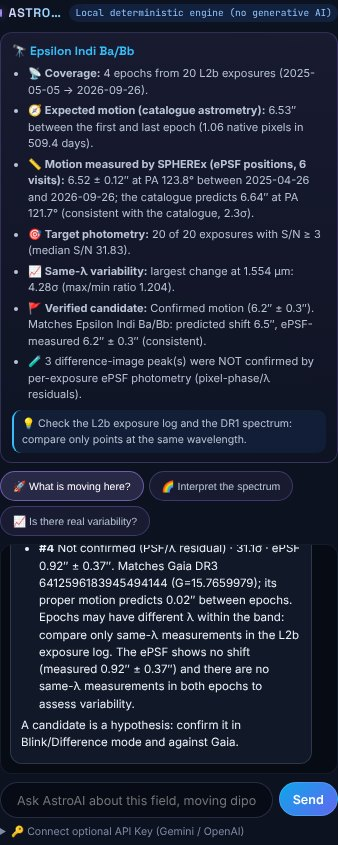

<em>Figure 15. AstroAI Copilot answering “What is moving here?” for Epsilon Indi Ba/Bb with the local deterministic engine (no API key). The key field is at the bottom of the panel.</em>

## 11. Saving and returning to reference objects

**+ New** adds your own reference target, and **Manage** lets you edit, delete or restore targets; the official astrometry of the challenge targets cannot be edited. Selecting a saved target returns the viewer to its coordinates and, if it has a proper motion, propagates its position to each exposure.

A saved coordinate is a navigation reference. It does not guarantee that new observations exist at that position or that the source is detected in every detector.

## 12. Exporting and sharing results

- **Share Link:** copies a direct link to the current target, epoch and settings. The recipient needs a running copy of the application to open it.
- **Export Blink GIF:** creates an animation of the available epochs. A GIF is useful for communication and visual review, but it is not a substitute for the calibrated exposure data or the measurement uncertainties.
- **CSV:** the button in the Target Spectrum panel exports the spectrum measurements.
- **MPC Report:** appears only when a candidate has confirmed motion and no stellar counterpart. It drafts an astrometric report in the Minor Planet Center satellite format (SPHEREx observatory code 288).

When reporting a candidate, include its coordinates, the dates of the observations, the detector or wavelength range, the measurement uncertainty, and any relevant quality warnings. State clearly whether the evidence comes from multi-epoch L2b data or a static DR1 co-add.

## 13. Known limitations and responsible interpretation

1. **A static DR1 image has no time axis.** If no L2b exposures are available, the application can display a DR1 image for context, but cannot produce a real blink, epoch difference, or measured light curve for that field.
2. **Saturation prevents reliable flux measurement.** The position of a saturated source may sometimes be estimated, but its flux must not be treated as valid.
3. **Blending can affect measurements.** Nearby sources can overlap within the SPHEREx image. ePSF fitting can help separate them in individual exposures, while a larger-aperture DR1 spectrum may still include a neighbour.
4. **Low S/N limits interpretation.** A faint source may only be detectable in some detectors or exposures. Upper limits are not detections.
5. **The image is undersampled.** Small changes in a star's pixel position can change its measured peak and mimic variability in a simple image comparison.
6. **The LVF is position-dependent.** Different exposures can measure a source at different wavelengths. Compare measurements at the same or sufficiently similar wavelengths before claiming brightness variability.
7. **The DR1 All-Sky Cube is a co-add.** Its pixels are larger than the native L2b pixels and it is intended for all-sky context and spectral reference, not precise time-domain astrometry.
8. **Planet X has not been detected.** The application is a tool for exploring and testing candidate signals; it does not claim the discovery of Planet X or any previously unknown planet.

## 14. Suggested first investigation: WISE 0855−0714

WISE 0855−0714 is a useful introductory target because it is a very cold brown dwarf with substantial proper motion.

1. Select **WISE 0855−0714** in the Reference Targets strip.
2. Check the propagated coordinates. The coordinates in the challenge statement are from the AllWISE epoch (2010.6); in 2026 the object is about 2.1′ away from them.
3. Use the long-wavelength detectors D5–D6 (4.4–5.0 µm), where it is detected; it is not detected below about 3.5 µm.
4. Check that the status indicator shows several epochs (SPHEREx has 3 visits of this field). If the app ever shows only static DR1 data, do not infer motion from it.
5. Play the available epochs and inspect the predicted-position marker.
6. Select the candidate/source measurement and review its S/N, centroid, and quality flags.
7. Compare the measured displacement with the predicted catalogue motion and read the uncertainty.
8. Inspect the spectrum, keeping in mind that a G = 16.3 star 8″ away dominates the DR1 spectrum below 3.5 µm.

Expected result: about half of the long-wavelength exposures detect it, at S/N ≈ 4 and about 1″ from the predicted position. This workflow shows how to combine visual inspection with measurements rather than relying on a single image feature.

## 15. Scientific references and data acknowledgement

The application uses public astronomical data and documented methods. Key resources include:

- SPHEREx Explanatory Supplement: https://irsa.ipac.caltech.edu/data/SPHEREx/docs/SPHEREx_Expsupp.pdf
- SPHEREx archive at NASA/IPAC IRSA: https://irsa.ipac.caltech.edu/Missions/spherex.html
- Official IRSA SPHEREx tutorials: https://caltech-ipac.github.io/irsa-tutorials/spherex/
- NASA Space Apps Challenge — Planet X and SPHEREx: https://www.spaceappschallenge.org/2026/challenges/planet-x-and-spherex/
- Gaia archive at MAST: https://archive.stsci.edu/missions-and-data/gaia
- Minor Planet Center satellite-observation format: https://www.minorplanetcenter.net/iau/info/SatelliteObs.html

**Data acknowledgement:** This application makes use of data products from the Spectro-Photometer for the History of the Universe, Epoch of Reionization and Ices Explorer (SPHEREx), a joint project of the Jet Propulsion Laboratory and the California Institute of Technology, funded by the National Aeronautics and Space Administration.

---

**SPHEREx SkyChrono — Stars Finders, Delegación Zuliana de Astronomía**  
*User Guide · NASA Space Apps Challenge 2026*
